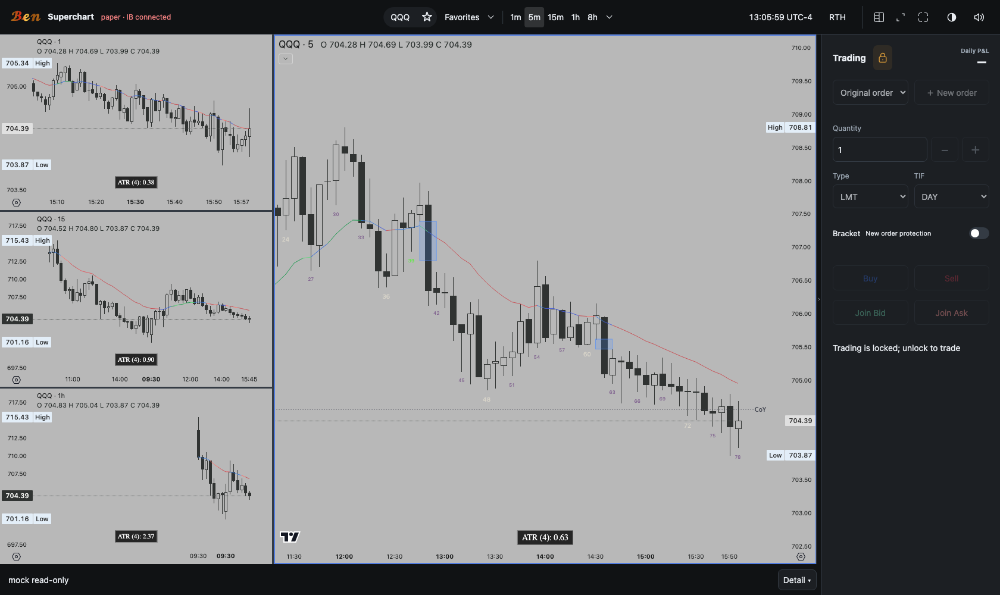
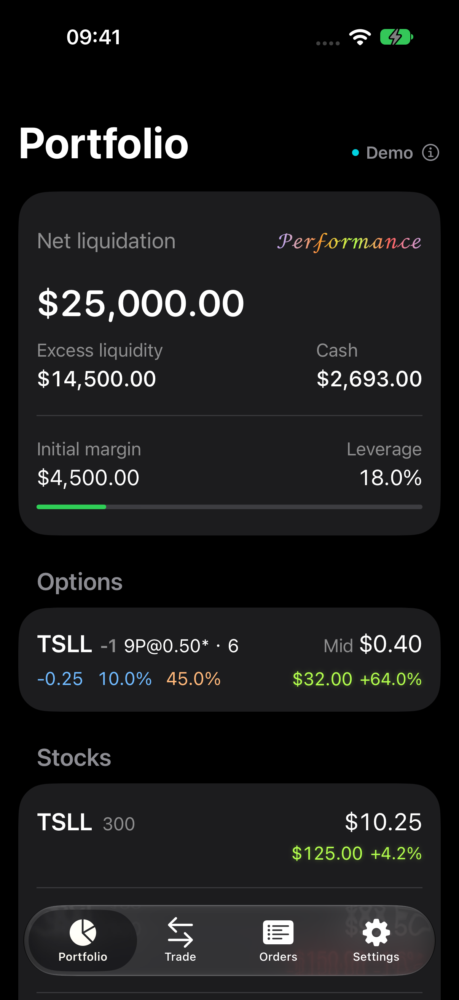
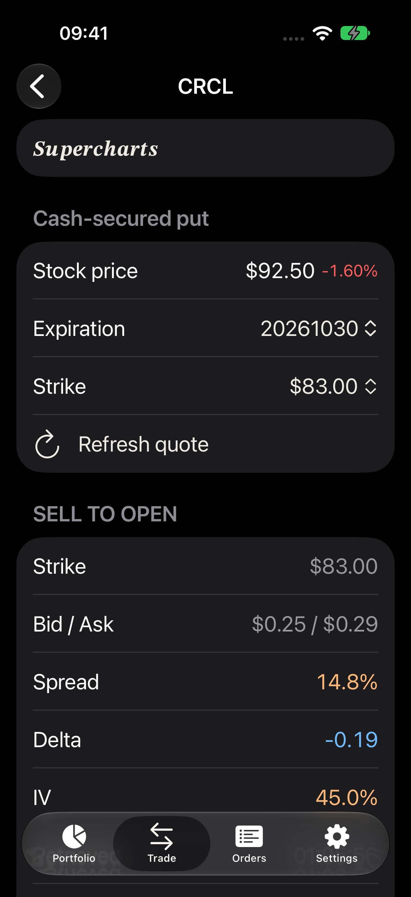
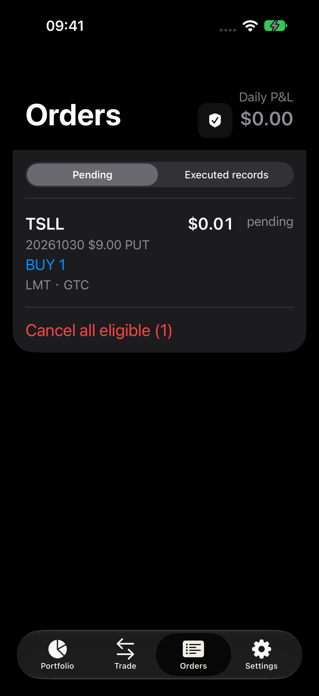
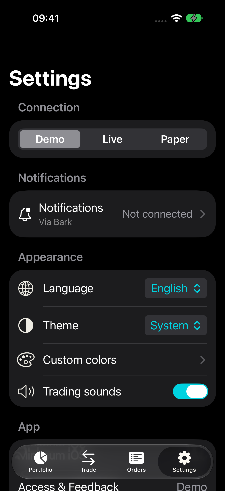
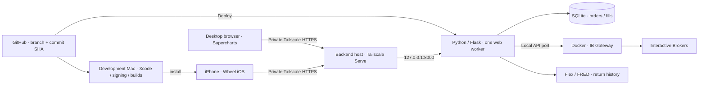

# AllYouNeedIsWheel — Wheel Trading for IBKR

**English** · [简体中文](README.zh-CN.md) · [繁體中文](README.zh-TW.md)

An unofficial, self-hosted iPhone and web trading workspace for Interactive Brokers.

**An iPhone and desktop workspace for the Wheel strategy.** View IBKR holdings, compare returns, screen cash-secured puts (CSP) and covered calls (CC), manage orders, and work across synchronized Supercharts.

Built with SwiftUI for iOS 18 and later, with light and dark themes. Current UI development uses English; existing localization resources remain, with a coordinated Chinese localization pass deferred until the features and interactions mature. The app connects to your own backend. IB authentication, market-data connections and databases stay on the backend host; the iPhone does not store your IB password.

The **desktop web workspace** brings 1/2/3/4 charts, drawings, indicators, price alerts and a trading panel into one screen. The **native iPhone app** provides Portfolio, Trade, Orders and charts on the same backend. The web layout also adapts to smaller screens.

> This README describes the current development branch. Building from source is not an App Store release. Publishing to GitHub, updating the backend and installing the iPhone app are three separate steps.

## Project status and versions

As of **2026-10-25**, Wheel is in everyday use and stability maintenance. Ordinary issues are collected and grouped for small, focused repairs; trading-safety problems and normal-use blockers take priority. Preserve the established layouts, tick-level market-data path and confirmed trading interactions. This direction does not imply acceptance of every scenario or Live trading workflow.

Official code is identified by repository, branch and commit SHA. The current target is **`Ben/wheel-1.8`**, not necessarily `main`. This review covers [`0745e3d`](https://github.com/WahBun/AllYouNeedIsWheel/commit/0745e3d3c3cf54a39809cceaff54774a9f96c349). The latest published release at this review is [Wheel: v1.8.2](https://github.com/WahBun/AllYouNeedIsWheel/releases/tag/v1.8.2); subsequent merged work is described below and is not a new release. Verify development, validated, merged, deployed and installed-iPhone versions separately.

Recommended roles: the **development Mac** handles development, Xcode and iPhone builds; the **backend host** runs Gateway, Backend and the API continuously. The development Mac and iPhone reach the backend host through Tailscale. The user chooses deployments and restarts from a computer or phone, and performs the iPhone Xcode Run.

## Reading guide

- Everyday use: [features and data boundaries](#features), [updating](#updating) and [troubleshooting](#troubleshooting).
- First installation: follow sections 1–7 below. If a backend service is already installed, use the update workflow instead of repeating first-start instructions.
- Detailed guides: [iOS builds and usage](ios/README.md), [account configuration and operations](docs/MAC_MINI_TAILSCALE.md), [Performance](docs/PERFORMANCE.md) and [market-data baseline](docs/MARKET_DATA_BASELINE.md).

## Screenshots

Captured on **2026-10-25** from the code reviewed above. iPhone Simulator views use built-in **synthetic Demo data**. The desktop screenshot renders a **QQQ RTH historical-price snapshot through 2026-10-23** in an isolated, read-only local preview with no account or position data; it is not a live broker session or trading acceptance.

### Desktop · Supercharts



### iPhone · Native app

| Portfolio | Trade · CSP / CC | Orders |
| :---: | :---: | :---: |
|  |  |  |

## Since the previous README review

- **A shared chart workspace:** a compact desktop toolbar, preserved 1/2/3/4 layouts, synchronized drawings and contract favorites; responsive web controls and a phone fullscreen fallback. Web positions default to options first.
- **Price alerts and phone notifications:** standalone thresholds and horizontal-ray alerts, draggable alert lines, in-chart notifications and optional Bark delivery. Monitoring runs on the backend for the selected account; a closed browser receives no browser push. See [alerts and notification setup](docs/PRICE_ALERTS_AND_PUSH.md).
- **MoonShine:** permanent QQQ and ES watches share pricing rules with chart levels. Levels depend on the session and eligible source data; monitoring pauses when required data or the account connection is unavailable. These are alerts, not automatic orders.
- **Recovery and stability:** focused repairs to order-state recovery and management of existing positions, alongside the preserved confirmation, quote-freshness and P&L rules. Merged code is not proof of installation or broker acceptance.

## Features

| Screen | Capabilities |
| --- | --- |
| **Portfolio** | Net liquidation value, expandable cash and liquidity, initial margin and leverage; stock and option holdings, entry fill prices, days remaining and P&L; allocation, position sharing, closing and rolling workflows. |
| **Performance** | MTD/YTD/ALL return curves, initially YTD; Portfolio only, SPX, NDX or SPX + NDX comparisons, initially both benchmarks; drag to inspect dates and returns; daily P&L and provisional intraday estimates. |
| **Trade** | CSP → CC workflow; expiration and strike selection, bid/mid/ask, spreads and Greeks; contract quantity and limit editing, premium estimates, CSP initial-margin-change estimates, individual or batch order drafts. |
| **Orders** | Pending orders and partial/full execution records; Today/7 Days/MTD, symbol search and Stock/Future/Option filters; commissions displayed to two decimals; order details, edits, execution, cancellation and fill notifications. |
| **Supercharts** | Stock, futures and option charts; position average prices, related option strikes, execution markers, multi-timeframe EMA, ATR, Bar Count, FVG, Previous values, volatility channels/extreme gauge and drawing tools; instrument search and shared favorites. |
| **Settings** | Demo/Live/Paper selection, Gateway auto-login status, private HTTPS connection, language, themes and custom colors. |

Available CC quantity accounts for shares held, existing short CALLs and active sell-order reservations. It is not simply total shares divided by 100. Position entry prices come from reliably matched fills; uncertain values remain unavailable rather than using a limit price or fee-adjusted position cost.

SGOV, VTI, QQQ, SPY and VOO have dedicated names and allocation animations. VTI/QQQ/SPY/VOO remain eligible in Trade; SGOV is excluded from Trade candidates. Decorative animations respect Reduce Motion and pause in the background or when their view is not visible.

### Supercharts and the 𝔹𝕖𝕟 indicator

Open **𝑺𝒖𝒑𝒆𝒓𝒄𝒉𝒂𝒓𝒕𝒔** from position details or the chart entry in Trade. Charts open for analysis without automatically creating an order preview; use the **+** beside a price when needed. Features include 1/2/3/4-chart layouts, timeframe selection, RTH/ETH, full screen and drawings with saved styles.

- **Positions and executions:** stocks show shares, options/futures show contracts, and short quantities are negative. Stock charts can also show related option strikes. Positions toggles these position markers. Fill arrows group partial fills of the same order while keeping separate orders distinct; select an arrow for details.
- **𝔹𝕖𝕟:** the indicator bar starts collapsed, with Inputs/Style/Visibility settings. It includes three independently configurable EMAs (default length 20, with multiple timeframes), ATR, Bar Count, FVG, Previous values, Volatility Channels and Intraday Extreme Gauge. Visibility and styles are configurable; availability depends on the instrument and data.
- **Loading and state:** cached historical bars and previously fetched multi-timeframe EMA history can appear after a restart before refreshing. First access still depends on IB history. Cached, frozen, delayed or missing data is not live market data. Demo does not provide the complete chart feed; charts need the backend.
- **Instruments and favorites:** search stocks/futures, or select an exact option through underlying → expiration → Call/Put → strike. Web and native clients share contract favorites through the same backend, up to 100 favorites. Selecting an instrument creates no order; favorite synchronization does not synchronize trading state or all display settings.
- **Drawing synchronization:** each contract offers **Main chart only** (main charts on computer and phone; hidden on auxiliary charts) and **All charts** (main and auxiliary charts on both). Both synchronize through the same backend, independently of timeframe. Activating or maximizing an auxiliary chart does not change its pane role. Drawings are analysis annotations, not broker orders.
- **Trading capabilities:** stocks, futures and supported standard USD options can use chart trading according to account capabilities. Join, entry, TP/SL, Add, Trim, BE and Close depend on the account, position, contract and backend capability switches. Existing protection, coverage and unresolved outcomes may restrict actions. A Live connection alone does not enable unrestricted trading; mock tests are not Live acceptance.
- **Price dragging:** with One-click trading on, releasing an editable entry or TP/SL line submits the amendment through existing guards. With it off, the draft stays until Confirm/Discard. Routine quote updates must not discard drafts; actual fills, cancellations or order-identity changes still require reconciliation.
- **Chart P&L:** Daily P&L uses IBKR data for the exact current contract and selected account. After 15 seconds without a fresh update, the label becomes `Daily P&L · Stale`; unavailable does not mean zero. `Realized today` uses persisted IB execution realized P&L, which differs from IB daily mark-to-market P&L.

### Execution-history filters

Executed records defaults to **Today**, with **7 Days** and **MTD** (from the first day of the current US Eastern month). Select **🔍** to expand search and **Filter** to choose Stock/Future/Option. The three filters combine. Search, Done or scrolling can dismiss the keyboard.

Date filters apply to records already obtained by the app, not all IB history. Records without reliable execution times are excluded from date ranges. Commissions round to two decimals for display only; original calculation precision is retained.

### Demo / Live / Paper



- **Demo:** synthetic local data, without IB. The address and Connect button are hidden, while a previously saved backend address is retained.
- **Paper:** the IBKR simulated account. With auto-login configured, selection switches the backend connection, reuses a signed-in Paper session or starts Gateway, verifies the account and restores data.
- **Live:** reuses a signed-in Live session. If authentication is needed, it selects the configured IB Key device and requires the user's phone approval. The app verifies the actual account; selecting Live alone does not establish a verified Live connection.

First configure separate `paper`/`live` connection profiles, databases and private login credentials on the backend host. Credentials do not enter GitHub or the iPhone. Auto-login is optional; without it, log into Gateway manually. See [account selection and auto-login](docs/MAC_MINI_TAILSCALE.md#ios-account-selector). The single-Gateway controller defaults to `~/Docker/ib-gateway/docker-compose.yml`; if using `~/Services/wheel-gateway` below, set `WHEEL_GATEWAY_COMPOSE_DIR` accordingly.

The backend has one selected account shared by all clients. Switching does not close positions or cancel orders. The app clears the previous account's views, and the backend rejects writes from old sessions. With account profiles enabled, legacy web clients without account-session identifiers are read-only.

**Fast Live ⇄ Paper switching:** optional same-container dual sessions keep Live and Paper signed in. Switching changes Wheel's account connection without restarting Gateway; valid sessions avoid repeated IB Key authentication. Each uses its own verified account connection, database and market data.

**Historical acceptance record (2026-10-07, not a current online-state check):** the user confirmed smooth switching in both directions on the phone. At that time, verified account selection took about **0.78 seconds** for Live → Paper and **0.95 seconds** for Paper → Live, with live quotes restored on both. These are API account-verification timings, not whole-screen or first-chart load times. The old account's chart-subscription cooldown no longer affected the new account's first load; that run did not reproduce the associated 503.

Cold startup, expired sessions or IB authentication requests still require login and user approval; no fixed timing is guaranteed. That historical test obtained live data from the existing subscription in same-container dual sessions; this does not establish subscription sharing for independent containers or arbitrary devices. Dual sessions require explicit configuration. Original single-Gateway and one-way prewarming modes remain available as fallbacks; the first-install example below uses one Paper/read-only instance. See [dual Gateway sessions and acceptance](docs/acceptance/2026-10-07-dual-gateway.md).

Those historical connection/data checks placed, amended and canceled no orders. They do not replace trading-workflow or market-open load acceptance.

### Data and order semantics

- **Demo** uses synthetic data and local simulated actions. It is not IB Paper Trading; that requires a Paper Gateway connection.
- **A draft is not a fill:** Trade tickets create drafts, and Execute in Orders submits them to IB. Chart trading has its own preview/confirmation and One-click paths; not every action first enters the draft list. Execution/cancellation confirmation preferences are configurable in order settings.
- External IB orders are read-only. An uncertain submission locks further writes until IB orders and fills are reconciled. A timeout never automatically resubmits a trading request.
- Frozen, stale or missing quotes do not become executable live prices. Connectivity does not establish all market-data permissions.
- Return history uses Flex daily TWR. SPX/NDX use FRED SP500/NASDAQ100 daily price indices without dividend reinvestment. Intraday estimates are not official TWR; the subsequent Flex report is authoritative.
- Rolling drafts and executes two legs separately; it is not an atomic combination order. Margin impact is an IB what-if estimate, not an additive allocation of account margin across positions.

### Refresh, cost and diagnostics

- **Charts and lists refresh separately:** charts use SSE push and tick-driven price/OHLC updates, with sequence and snapshot recovery after disconnects. The 1/2-second intervals below describe list/ticket reads, not a chart refresh ceiling. Arrival frequency depends on IB, entitlements, market activity and networking. See the [market-data baseline](docs/MARKET_DATA_BASELINE.md) for measurements and limits.
- **Quote freshness:** the last trade and executable bid/ask are different. Only valid live bid/ask updates or positive same-side size updates with a valid price refresh the corresponding executable quote. Cached/delayed data and local clocks cannot manufacture freshness. Chart OHLC updates also do not prove complete real-time volume; unknown volume is not zero.
- Single-symbol Trade details and close tickets target about one second; Portfolio and Trade lists usually target about two seconds. Reads are sequential, failures back off, hidden views pause, and request duration affects actual intervals.
- Portfolio option metrics check every 30 seconds when the market is confirmed closed and quotes are frozen, avoiding repeated retries for normally unavailable Delta/IV. Missing intraday values retry faster; availability still depends on IB and entitlements.
- Stock details may show matched IB report average cost, report date and quantity, separately from current Gateway cost. Report values do not replace trading inputs or live P&L; quantity mismatches request reconciliation.
- CSP initial margin is the expected change returned by IB what-if, refreshable on demand. Positive means increased usage and negative means decreased usage; it is not cash collateral. Estimation submits no real order.
- Once an order leaves Pending, details retain confirmed terminal and fill data. Unresolved results remain explicitly unconfirmed; disappearance alone proves neither a fill nor a successful cancellation.
- Select the **Portfolio/Orders status bar → Diagnostics** to preview and copy redacted diagnostics: version, refresh state, error category and available request identifiers. Raw errors, accounts, positions, private addresses and credentials are excluded. Clipboard content is local-only and expires after five minutes.

## Deployment architecture

The **backend host** is the always-on computer running IB Gateway, Wheel API and databases; no particular Mac model is required. The **development Mac** runs Xcode. They can be the same machine. Installation, startup and maintenance examples below target **macOS**. Linux/Windows service management and paths require adaptation; deployments on those systems are unverified.



| Device/component | Role |
| --- | --- |
| Development Mac | Xcode, Simulator, SwiftUI, signing and physical-device installation. |
| Backend host | Continuous Docker Gateway, Python backend, SQLite and Tailscale services. |
| iPhone | App views and actions over the Tailnet connection to the backend host. |
| GitHub | Official source: Commit → Push before changing computers, then Pull on the other computer before development. |

**Docker below runs only IB Gateway. The Wheel backend runs in a Python virtual environment on the backend host.** The repository has no one-command full-stack Docker deployment script.

## 1. Prerequisites

- **Backend host:** Git, Python 3.10+, Docker Desktop and Tailscale; stable connectivity and system sleep disabled.
- **Development Mac:** Git, Xcode compatible with the project and target device, and Apple ID/development signing; physical iPhones require iOS 18+.
- **iPhone:** Tailscale in the same Tailnet as the backend host.
- **IBKR:** a valid Gateway login, the intended account and required data permissions. Start with Paper/read-only verification.

Clone and install backend dependencies on the backend host:

```sh
mkdir -p "$HOME/Projects"
cd "$HOME/Projects"
git clone --branch Ben/wheel-1.8 https://github.com/WahBun/AllYouNeedIsWheel.git
cd AllYouNeedIsWheel
git branch --show-current
git rev-parse HEAD
python3 -m venv .venv
source .venv/bin/activate
python -m pip install -r requirements.txt
cp connection.json.example connection.json
```

This example explicitly selects the documented branch. If the maintenance branch changes, verify its GitHub branch and SHA first. For an existing installation, do not clone over the running directory or overwrite settings/databases. Check `git status`, branch and SHA, then follow [updating](#updating).

## 2. Backend host: IB Gateway in Docker

Use the independent upstream [gnzsnz/ib-gateway-docker](https://github.com/gnzsnz/ib-gateway-docker) image. This is a first-install Paper/read-only example, not a reset procedure for an existing service.

Create and enter a private directory outside the repository:

```sh
mkdir -p "$HOME/Services/wheel-gateway"
cd "$HOME/Services/wheel-gateway"
```

Save `docker-compose.yml` there:

```yaml
services:
  ib-gateway:
    image: ghcr.io/gnzsnz/ib-gateway:stable
    restart: unless-stopped
    environment:
      TWS_USERID: ${TWS_USERID:?Set TWS_USERID}
      TWS_PASSWORD: ${TWS_PASSWORD:?Set TWS_PASSWORD}
      TRADING_MODE: ${TRADING_MODE:-paper}
      READ_ONLY_API: ${READ_ONLY_API:-yes}
      VNC_SERVER_PASSWORD: ${VNC_SERVER_PASSWORD:?Set VNC_SERVER_PASSWORD}
      TWS_SETTINGS_PATH: /home/ibgateway/tws_settings
    ports:
      - "127.0.0.1:4001:4003"
      - "127.0.0.1:4002:4004"
      - "127.0.0.1:5900:5900"
    volumes:
      - gateway-settings:/home/ibgateway/tws_settings
volumes:
  gateway-settings:
```

Create `.env` in the same directory, with credentials filled in only on the backend host:

```dotenv
TWS_USERID=YOUR_PAPER_USERNAME
TWS_PASSWORD=YOUR_PAPER_PASSWORD
VNC_SERVER_PASSWORD=YOUR_PRIVATE_VNC_PASSWORD
```

```sh
chmod 600 .env
docker compose pull
docker compose up -d
docker compose ps
```

On the backend host, use a screen-sharing/VNC client at `vnc://127.0.0.1:5900` to check Gateway login and API settings and complete IB Key/two-factor authentication when required. Do not expose VNC or IB API ports publicly. A running container does not establish a signed-in Gateway.

The image forwards **Paper through container port 4004 → host port 4002**; Live uses container port 4003 → host port 4001. Do not confuse forwarding ports with Gateway's internal ports. On Apple Silicon, select an upstream ARM64-compatible image. After verification, pin a version or digest to avoid unplanned upgrades. See [upstream deployment details](https://github.com/gnzsnz/ib-gateway-docker#ports).

Docker Desktop must start when the user logs in. Container restart policy cannot start Docker Desktop or bypass IB authentication. Do not start another Gateway that conflicts with an existing account session.

## 3. Backend host: connect the Python backend

Return to the cloned repository root (`~/Projects/AllYouNeedIsWheel` in this example) and edit `connection.json` consistently with the previous step:

```json
{
  "host": "127.0.0.1",
  "port": 4002,
  "client_id": 1,
  "readonly": true,
  "account_id": "YOUR_PAPER_ACCOUNT_ID",
  "db_path": "options_dev.db"
}
```

Use a stable `client_id` that does not conflict with other apps and the actual target `account_id`. Filenames do not determine Paper/Live; the Gateway session, port and verified account do.

```sh
cd "$HOME/Projects/AllYouNeedIsWheel"
source .venv/bin/activate
python run_api.py
```

Verify from another terminal:

```sh
curl --fail http://127.0.0.1:8000/health
curl --fail http://127.0.0.1:8000/api/portfolio/bootstrap
curl --fail http://127.0.0.1:8000/api/options/market-session
```

`/health` confirms HTTP service health only. Also verify the portfolio response belongs to the intended account. Do not post account responses or unredacted logs in public issues.

The backend uses **one web worker process, eight HTTP threads and one serialized IB execution thread**. Identical reads may share work; writes are never coalesced or automatically retried. Do not increase Gunicorn worker count for speed or start duplicate backend instances.

`run_api.py` is the first manual-start entry point and may install missing dependencies. Do not run it alongside an existing persistent service. It sets the connection configuration from command-line flags. For custom `CONNECTION_CONFIG`, use the direct Gunicorn startup in the operations guide; this script does not preserve an arbitrary existing value.

Before enabling trading, verify Gateway Read-Only API, backend `readonly`, the target account and per-asset Live capability switches. Live also needs the correct Gateway session/port. `python run_api.py --realmoney` merely selects `connection_real.json`; it does not verify the intended Live account.

## 4. Backend host → iPhone: private Tailscale HTTPS

Join the backend host, development Mac and iPhone to the same Tailnet, with access limited to the required devices. Enable MagicDNS and HTTPS, then run on the backend host:

```sh
tailscale status
tailscale serve --bg --https=443 http://127.0.0.1:8000
tailscale serve status
```

Use the **complete HTTPS hostname** printed by Serve, for example:

```text
https://YOUR-BACKEND.YOUR-TAILNET.ts.net
```

Keep Tailscale connected on the iPhone, open the hostname's `/health` in Safari, then enter the same root URL in Wheel → Settings and select Connect. Before remote use, also verify over cellular data.

Do not use Funnel or public router port forwarding, or disable TLS verification. `--bg` persists the background Serve configuration but still requires the backend host and Tailscale online. Certificate Transparency logs expose certificate hostnames, so avoid private information in device names. See [Tailscale Serve](https://tailscale.com/docs/features/tailscale-serve) and the [command reference](https://tailscale.com/docs/reference/tailscale-cli/serve).

## 5. Development Mac: build and install the iOS app

Clone the same repository on the development Mac and open `ios/Wheel.xcodeproj`. The app has no external Swift package dependencies.

Beside `ios/Signing.xcconfig`, create the Git-ignored `Signing.local.xcconfig`:

```xcconfig
DEVELOPMENT_TEAM = YOUR_TEAM_ID
PRODUCT_BUNDLE_IDENTIFIER = com.yourname.wheel
```

In Xcode Signing & Capabilities, select your Team and automatic signing. Keep the same bundle identifier to update an existing installation; a different identifier creates a separate app.

1. Connect and unlock the iPhone by cable for the first pairing, confirm trust and enable Developer Mode when required.
2. Select your iPhone as the run destination and build/install.
3. Use the **Wheel Wireless** scheme for everyday use: a Debug build that launches without LLDB, reducing wireless-debugging overhead.
4. Use the **Wheel** scheme when breakpoints and debugging are needed.
5. The app first opens in Demo. Select Paper or Live to reveal connection settings, enter the HTTPS URL and select Connect. Auto-login requires the backend account configuration described earlier.

### Wireless Run

Complete wired pairing first and check device/network availability in Xcode Devices and Simulators before unplugging. The development Mac and iPhone should share a local network that permits device-to-device access. Guest Wi-Fi, client isolation and VPN rules can block debugging.

iPhone screen mirroring and wireless Xcode installation have different requirements. Tailscale connects the app to the backend host; it does not configure wireless Xcode debugging.

Simulator can run Demo directly. This does not verify physical-device signing, wireless access or Live data. Signing validity and device limits depend on Apple's current rules.

## 6. Configure Performance history

A working Portfolio view does not establish configured return history. The backend host needs IBKR Flex daily Change in NAV with TWR, From/To Date and Starting/Ending Value, broken out by day. CSV needs CNAV section codes. The report account must match the Gateway configuration.

Create the private file on the backend host:

```text
~/Library/Application Support/Wheel/performance/config.json
```

```json
{
  "token": "YOUR_FLEX_TOKEN",
  "query_id": "YOUR_FLEX_QUERY_ID",
  "account_id": "YOUR_CONFIGURED_GATEWAY_ACCOUNT",
  "history_path": "/ABSOLUTE/PRIVATE/PATH/performance-history.sqlite3"
}
```

Create parent directories first, set the configuration file to mode `600`, and ensure the `history_path` parent is writable. `WHEEL_PERFORMANCE_CONFIG` can select another private configuration path. Alternatively, `report_path` imports an existing CSV/XML file.

Do not put the token in the app, Git or `connection.json`. Flex uses a separate private configuration; connection settings and diagnostics must not become secret containers. Back up the history archive separately. ALL displays saved history and cannot invent missing periods since account inception. See [Performance configuration](docs/PERFORMANCE.md) for report formats, caching and estimation boundaries.

## 7. Persistent services and updates

Use a LaunchAgent to start the Python backend after user login. The full plist and load/stop commands are in the [backend operations guide](docs/MAC_MINI_TAILSCALE.md#3-macos-登录后自启动). The default is `connection.json`; other files require explicit `CONNECTION_CONFIG` in the LaunchAgent's `EnvironmentVariables`. Supply custom Flex paths through the environment too.

After rebooting the host, verify FileVault unlock, user login, Docker Desktop, Gateway authentication, Tailscale and Backend separately. Container auto-restart alone does not establish full recovery.

### Optional host maintenance

Two separate user-level maintenance tasks are provided and must be explicitly installed on the backend host. Pulling code does not enable them:

| Task | Behavior and limits |
| --- | --- |
| Docker watchdog | Detects failures and attempts guarded recovery. Recovery that restarts Gateway interrupts it and may require IB Key/manual login. It is not an unconditional periodic restart. |
| Database backup and log rotation | Checks hourly. SQLite online backup saves one orders/history copy per UTC date, verifies integrity and retains the latest 14 copies. Gunicorn access/error logs rotate at 20 MiB, retaining seven archives. |

The maintenance script currently targets `options_dev.db` at the repository root. If using another database path, adapt the script before installation. Custom Flex configuration paths must also reach the maintenance task, not just Backend.

Backups remain in the host's private `~/Library/Application Support/Wheel/Maintenance` directory outside GitHub. They support local recovery but **do not protect against disk failure or loss of the whole machine**. Log rotation asks Gunicorn to reopen files without restarting workers; it does not truncate LaunchAgent output or other apps' logs.

See the [backend operations guide](docs/MAC_MINI_TAILSCALE.md) for installation, state files, troubleshooting and recovery. Tasks require user login and an online host. Avoid system sleep; if sharing a keyboard/mouse through Universal Control, choose a display-sleep policy compatible with that use.

### Updating

1. **Develop and push on the development Mac:** verify branch/worktree, run relevant checks, then Commit → Push. Preserve uncommitted changes. Exclude settings, IB/Flex credentials, databases, logs, private addresses and personal signing details from Git.
2. **Preview from computer or phone:** open the configured **Wheel Backend** shortcut, choose **Deploy latest**, and inspect branch, current/target SHA, commit subject and restart advice. Confirmation pins that exact SHA even if the branch advances afterward.
3. **Choose deployment mode:** select **Deploy only** or **Deploy & Restart Backend** in the second menu. Use **Restart Backend only** from the outer menu to restart the existing version. Canceling performs no deployment or restart.
4. **Verify affected components:** check backend-host SHA, Backend health and actual pages. Reload web assets after updates. Native iOS changes and bundled chart assets require a separate Xcode build/install on the development Mac. GitHub pushes and backend deployment do not update the installed iPhone app.

| Choice/advice | Meaning |
| --- | --- |
| **Deploy only** | Updates backend-host code and checks health without changing the Backend process. It does not prove running Python loaded the new code. Appropriate for documentation and other changes that need no restart. |
| **Deploy & Restart Backend** | Updates to the confirmed SHA, restarts Wheel Backend and checks the new process/health. It does not restart Gateway. Use only when no order request is in flight or awaiting reconciliation. |
| **No restart expected** | Recognized changes are not expected to need Backend restart. A web reload or iPhone rebuild may still be needed. |
| **Restart recommended** | Backend Python, cached templates or similar changes need a restart; advice also considers earlier code-only deployments still awaiting one. |
| **Review required** | Dependencies, migrations, configuration or unknown files need review. A restart alone may be insufficient. |

Advice does not choose for the user. Each fix should state validation scope, recommended deployment mode and why. Record backend, web and phone acceptance separately. Health checks do not establish broker connectivity, correct account routing, market-data quality or order acceptance.

The shortcut fetches published GitHub code from the backend host. After setup, either computer or phone can trigger it without leaving the development Mac on. The backend host, Tailscale, GitHub access and existing device SSH authorization must be available. Preview confirms code versions/advice, not full deployment or an updated phone app. Backend-host GitHub authentication and phone-to-host SSH authorization are separate setup requirements.

Deployment checks worktree, branch and forward ancestry and keeps a code rollback point. It never overwrites conflicts, installs dependencies or migrates databases automatically. Back up private settings/databases as needed; running SQLite needs online backup API/`.backup`. Do not bypass failures with `git reset --hard`, database deletion or removal of unfinished deployment records, and never blindly replay trading writes after disconnects.

See the [Wheel Backend shortcut](docs/BACKEND_SHORTCUT.md#choose-whether-to-restart-2026-10-16) and [development Mac → backend host deployment tool](docs/DEPLOY_MINI.md). The latter is a separate entry point that requests a Backend restart; it is not the shortcut's Deploy only mode.

### Reporting problems

Record the screen, reproduction steps, expected/actual behavior, time and Demo/Paper/Live mode. Add screenshots or redacted Diagnostics, and backend branch/SHA and installed app version when available. For quotes, include instrument, timeframe and market-open state. For orders, retain broker evidence for reconciliation; do not reproduce problems by deleting records or repeatedly submitting requests.

Fix actual user paths with minimal changes while preserving stable layout and behavior. UI, interaction, market-data refresh, order chains, state synchronization and reconnect work require relevant REA analysis before implementation and focused validation afterward. Clearly identify anything unverified on the actual page, device or broker environment.

## Troubleshooting

| Symptom | Check in order |
| --- | --- |
| App cannot connect | Host-local `/health` → portfolio API → Tailscale on both ends → HTTPS hostname and access policy. |
| TLS failure / `-1200` | Open the same address in Safari; check time, certificate, Tailscale and proxy interference. Do not disable verification. |
| Holdings without quotes | Gateway login, entitlements, instrument availability and market session. Old/frozen data is not live. |
| Empty Performance chart | Flex configuration, account match, daily TWR and saved history. Demo has no real return history. |
| HTTP 503 / slow first quote | Serialized IB work or initial contract resolution can take time. Wait for read recovery; do not repeat trading writes. |
| Wireless iPhone unavailable | Initial pairing, unlock, local-network device access, VPN and router isolation. |
| Slow launch after wireless Run | Use Wheel Wireless without the debugger; switch to Wheel for debugging. |
| Uncertain order state | Reconcile the exact IB order and partial fills before clearing a lock. No automatic replacement submission. |
| Connection/refresh feedback | Select the Portfolio/Orders status bar to preview/copy Diagnostics; include screenshots if useful. |

Trade automatic quotes use the NYSE regular-session calendar, including holidays, early closes and daylight saving. This is not a trading-permission decision for every stock, option or extended session. Performance's provisional intraday curve also has limited eligibility conditions.

## Development and validation

```sh
# Run from the repository root; activate the backend virtual environment first
# Isolated checks prohibit network access, real IB construction and persistent DB access
python tests/run_chart_offline.py

# Frontend unit tests require Node.js with node:test support
npm run test:frontend

# iOS: list available simulators, then replace SIMULATOR_ID with your local target
xcrun simctl list devices available
xcodebuild -project ios/Wheel.xcodeproj -scheme Wheel \
  -destination 'platform=iOS Simulator,id=SIMULATOR_ID' test

git diff --check
```

These are validation entry points, not a claim that every test ran on this commit. Browser interaction checks in `tests/chart/*.cjs` are separate from `npm run test:frontend` and need an isolated Playwright/browser environment. See the [market-data baseline](docs/MARKET_DATA_BASELINE.md#repeatable-checks) for setup and the chart matrix. Select checks relevant to the change and avoid starting test services against production settings.

Mock checks are not broker acceptance. Builds/regressions do not establish market-open latency, real fills, every network failure or every iOS device. Real Paper orders require explicit authorization; Live trading is user-operated.

```text
iOS project: ios/Wheel.xcodeproj
Native views and state: ios/Wheel/
iOS regressions: ios/WheelTests/
Backend routes and services: api/
IB connection/configuration: core/, config.py
Order database: db/
Backend/web regressions: tests/
Web workspace: frontend/
Deployment/data guides: docs/
```

See the [iOS guide](ios/README.md) for build details. Web and iPhone share backend data and supported synchronization; browser preferences do not automatically migrate to the app.

## License & Credits

[Apache License 2.0](LICENSE). The project continues development from [xiao81/AllYouNeedIsWheel](https://github.com/xiao81/AllYouNeedIsWheel). Thanks to [TradingView Lightweight Charts](https://github.com/tradingview/lightweight-charts), [ib_async](https://github.com/ib-api-reloaded/ib_async), SwiftUI/Charts, Flask, [IB Gateway Docker](https://github.com/gnzsnz/ib-gateway-docker) and [Tailscale](https://tailscale.com/) for the underlying tools.
