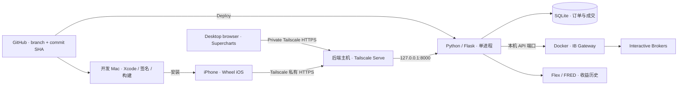

# AllYouNeedIsWheel — Wheel Trading for IBKR

[English](README.md) · **简体中文** · [繁體中文](README.zh-TW.md)

An unofficial, self-hosted iPhone and web trading workspace for Interactive Brokers.

**Wheel 策略的 iPhone 与桌面工作台。** 查看 IBKR 持仓、比较收益、筛选现金担保看跌期权（CSP）和备兑看涨期权（CC）、管理订单，并通过多图 Supercharts 分析行情。

SwiftUI 构建，支持 iOS 18 及以上，以及浅色／深色模式。当前 UI 开发统一使用英文；已有本地化资源保留，完整中文本地化待功能与交互成熟后统一整理。App 连接你自己运行的后端；IB 登录、行情连接和数据库留在后端主机，iPhone 不保存 IB 密码。

**桌面网页工作台**将 1／2／3／4 图、画线、指标、价格提醒和交易面板放在同一屏幕；**原生 iPhone App** 提供 Portfolio、Trade、Orders 与图表，两端共用后端。网页布局也适配较小屏幕。

> 本文对应当前开发分支。源码构建安装不等于 App Store 发布；更新 GitHub、更新后端服务和安装手机 App 是三个独立步骤。

## 当前阶段与版本

截至 **2026-10-25**，项目以日常使用和稳定性维护为主：普通问题先收集归类，攒一批做最小修复；交易安全或影响正常使用的问题及时处理。保留现有布局、tick 级行情刷新和已确认的交易交互。这一维护方向不代表所有场景或 Live 交易均已验收。

正式代码以仓库、目标分支和 commit SHA 为准。本次版本为 [Wheel: v1.8.3](https://github.com/WahBun/AllYouNeedIsWheel/releases/tag/v1.8.3)，目标分支为 **`Ben/wheel-1.8`**；Release tag 标识准确源码提交，不默认 `main` 最新。网页版本标记为 1.8.3，原生 iOS 重新构建安装后 Settings 显示 **1.8.3 (3)**。GitHub 发版不等于 Mini 已部署或 iPhone 已更新。

推荐分工：**开发 Mac** 负责开发、Xcode 与手机构建；**后端主机** 长期运行 Gateway、Backend 和 API；开发 Mac 与 iPhone 通过 Tailscale 访问后端主机。部署与重启由用户在电脑或手机上选择执行，手机 App 的 Xcode Run 也由用户操作。

## 阅读导航

- 日常使用：[功能与数据边界](#app-能做什么)、[更新流程](#更新流程)、[常见问题](#常见问题)。
- 首次安装：按下文第 1–7 节完成；后端主机已安装服务时请直接查看更新流程，不重复执行首次启动步骤。
- 专项说明：[iOS 构建与操作](ios/README.md)、[账户与运维](docs/MAC_MINI_TAILSCALE.md)、[Performance](docs/PERFORMANCE.md)、[行情刷新基线](docs/MARKET_DATA_BASELINE.md)。

## 界面预览

截图于 **2026-10-25**，对应上述代码。iPhone 模拟器使用内置 **Demo 合成数据**；桌面截图在隔离、只读的本地预览中展示 **截至 2026-10-23 的 QQQ RTH 历史行情快照**，不含账户或持仓数据，不代表当前券商连接或交易验收。

### 桌面网页 · Supercharts


### iPhone · 原生 App

| Portfolio · 持仓概览 | Trade · CSP / CC | Orders · 订单管理 |
| :---: | :---: | :---: |
|  |  |  |

## 这段时间的变化

- **跨端图表工作台：**桌面工具栏更紧凑，保留 1／2／3／4 图、画线与合约收藏同步；网页补齐窄屏布局和手机全屏回退。网页持仓默认期权在上。
- **价格提醒与手机通知：**支持独立价格阈值、水平射线提醒、拖动提醒线、图内通知及可选 Bark 推送。后端监控当前选中账户；关闭网页不会收到浏览器推送。配置与边界见[价格提醒与通知](docs/PRICE_ALERTS_AND_PUSH.md)。
- **MoonShine：**QQQ 与 ES 常驻监控和图表价位共用定价规则。价位取决于交易时段及有效数据；必要数据或账户连接不可用时暂停监控。提醒不会自动下单。
- **恢复与稳定性：**针对订单状态恢复、已有持仓管理做局部修复，保留确认流程、报价新鲜度及 P&L 语义。代码已合入不等于已安装或已通过券商验收。

## App 能做什么

| 页面 | 主要功能 |
| --- | --- |
| **Portfolio** | 净资产、可折叠现金与流动性、初始保证金及杠杆占比；股票与期权持仓、成交入场价、剩余天数和盈亏；资产分配、持仓分享、平仓与移仓入口。 |
| **Performance** | MTD／YTD／ALL 收益曲线（默认 YTD），可选 Portfolio only、SPX、NDX 或 SPX + NDX（默认两项对比），拖动查看日期与收益，日内盈亏及临时收益估算。 |
| **Trade** | CSP → CC 工作流，选择到期日与行权价、查看 bid／mid／ask、价差及 Greeks；合约数量和限价编辑、权利金估算、CSP 初始保证金变化预估、单笔或批量暂存订单。 |
| **Orders** | 待处理订单、部分及全部成交记录；Today／7 Days／MTD 日期筛选、标的搜索、Stock／Future／Option 分类；手续费保留两位小数；订单详情、编辑、执行、撤单与成交通知。 |
| **Supercharts** | 股票、期货和期权图表入口；持仓均价、关联期权行权价、成交标记、多周期 EMA、ATR、Bar Count、FVG、Previous values、波动通道／极值仪表与绘图工具；标的搜索和跨端收藏。 |
| **Settings** | Demo／Live／Paper 切换、Gateway 自动登录状态、私有 HTTPS 连接、语言、主题及自定义颜色。 |

CC 可用数量依据持股数量、已有空头 CALL 和占用中的卖出订单计算，而不是简单地把全部股票除以 100。持仓的入场价来自可靠匹配的成交记录；无法确定时留空，不用委托价或扣费后持仓成本冒充。

SGOV、VTI、QQQ、SPY、VOO 有专属名称与资产分配动效。VTI／QQQ／SPY／VOO 仍可用于 Trade；SGOV 排除在 Trade 候选之外。装饰动画支持减少动态效果，并在后台或对应视图离开时暂停。

### Supercharts 与 𝔹𝕖𝕟 指标

从持仓详情的 **𝑺𝒖𝒑𝒆𝒓𝒄𝒉𝒂𝒓𝒕𝒔** 或 Trade 的图表入口打开。进入图表以看走势为主，不自动铺设下单预览；需要时点击价格旁的 **+**。支持 1／2／3／4 图布局、周期切换、RTH／ETH、全屏和可保存样式的绘图工具。

- **持仓与成交**：正股显示股数，期权／期货显示合约数，空头用负号；正股图可同时显示相关期权的行权价。Positions 开关隐藏／显示这些持仓标记。成交箭头按订单归组，同一订单分批成交合并数量，独立订单分别显示；点击箭头查看详情。
- **𝔹𝕖𝕟**：指标栏默认收起，设置按 Inputs／Style／Visibility 分组。包含三组可独立配置的 EMA（默认长度 20，支持多周期）、ATR、Bar Count、FVG、Previous values、Volatility Channels 和 Intraday Extreme Gauge。各项显示与样式可配置，指标的可用性取决于标的及相关数据。
- **加载与状态**：历史 K 线和已获取的多周期 EMA 历史可在重启后先从缓存显示，再刷新。首次打开仍依赖 IB 历史数据；缓存、冻结、延迟和缺失状态不等于实时行情。Demo 不提供完整图表行情，图表需连接后端。
- **标的与收藏**：搜索股票／期货，或按标的 → 到期日 → Call／Put → 行权价选择精确期权合约。网页与原生 App 通过同一后端共享合约收藏（最多 100 项）；选择标的不会创建订单，收藏同步也不等于交易状态或全部显示设置同步。
- **绘图同步**：同一合约只提供 **Main chart only**（电脑／手机主图显示，副图隐藏）和 **All charts**（两端主图及副图均显示）。两项都通过同一后端跨设备同步，不按 K 线周期筛选；激活或放大副图不会改变它的主副图身份。绘图不是券商订单。
- **交易能力**：股票、期货与受支持的标准 USD 期权可按账户能力使用图表交易。Join、入场、TP／SL、Add、Trim、BE、Close 是否可用，以当前账户、持仓、合约及后端能力开关为准；已有保护单、覆盖数量和未确认结果可能限制操作。Live 并非连接后即可任意交易，模拟测试也不等于实盘验收。
- **价格拖动**：One-click trading 开启时，松开可编辑的入场或 TP／SL 线会通过现有校验提交修改；关闭时保留草稿，等待 Confirm／Discard。普通行情刷新不应丢失草稿，真实成交、撤单或订单身份变化仍会触发重新核对。
- **图表盈亏**：Daily P&L 对应当前精确合约与所选账户的 IBKR 数据；超过 15 秒未更新时显示 `Daily P&L · Stale`，不可用不显示成零。显示 `Realized today` 时使用已保存的 IB 成交已实现盈亏，含义与 IB 的每日盯市 P&L 不同。

### 成交记录筛选

Executed records 默认 **Today**，可切换 **7 Days** 或 **MTD**（美东本月 1 日至今）。右侧 **🔍** 点击展开搜索，**Filter** 按 Stock／Future／Option 筛选，三个条件可以组合。搜索键、Done 或滑动列表可收起键盘。

日期筛选作用于 App 已取得的成交记录，不承诺补全 IB 全部历史；没有可靠成交时间的记录不混入日期范围。手续费仅在显示时四舍五入为两位小数，原始计算精度保留。

### Demo / Live / Paper


- **Demo**：使用本地合成数据，不连接 IB。隐藏地址和 Connect，已保存的后端地址仍保留。
- **Paper**：使用 IBKR 模拟账户。配置好自动登录后，选择即切换后端连接，复用已登录的 Paper 会话或启动 Gateway，核对实际账户后自动恢复数据。
- **Live**：复用已登录的 Live 会话；需要重新认证时自动选择 IB Key 验证设备，收到通知后需本人在手机确认。App 核对实际账户，不会仅凭选中 Live 就显示实盘已连接。

首次使用需在后端主机配置 `paper`／`live` 两份连接配置、独立数据库及本机私有登录凭据；凭据不进入 GitHub，也不发送到 iPhone。自动登录是可选功能，未配置时仍需手动登录 Gateway。具体配置见[账户切换与自动登录](docs/MAC_MINI_TAILSCALE.md#ios-account-selector)。单 Gateway 自动登录控制器默认使用 `~/Docker/ib-gateway/docker-compose.yml`；若采用下方的 `~/Services/wheel-gateway`，请设置 `WHEEL_GATEWAY_COMPOSE_DIR` 指向该目录。

后端只有一个当前账户，所有客户端共享这个选择。切换不平仓、不撤单；App 清理旧账户画面，后端拒绝旧会话的写入请求。启用账户配置后，不支持账户会话标识的旧网页客户端只能读取。

**Live ⇄ Paper 快速切换**：可选的同容器双会话模式让 Live 和 Paper 保持后台登录。切换时只更换 Wheel 的账户连接，不重启 Gateway；会话有效时无需反复进行 IB Key 验证。两边使用各自的账户连接、数据库和行情，订单仍归属经过核对的当前账户。

**历史验收记录（2026-10-07，并非当前在线状态检查）**：用户已在手机确认双向切换流畅；当时后端接口测得 Live → Paper 约 **0.78 秒**、Paper → Live 约 **0.95 秒**，两边均恢复实时行情。此为账户核对完成的接口耗时，不等于手机整页或首次图表加载时间。已修复旧账户的图表订阅冷却影响新账户首次加载的问题；当次复测未出现该场景的 503。

首次启动、会话失效或 IB 要求重新认证时，仍需等待登录及本人确认，不能保证固定秒数。上述历史验收中，同一容器内的双会话取得了现有订阅的实时行情；这不代表两个独立容器或任意设备组合都支持共享。双会话模式需显式配置，原单 Gateway 与单向预热方案保留作回退；下方首次部署示例仍是 Paper／只读单实例。实现、启用配置与验证记录见[双 Gateway 会话与切换验收](docs/acceptance/2026-10-07-dual-gateway.md)。

上述历史连接与行情验收未下单、改单或撤单，不替代交易流程及开市负载验收。

### 数据与订单的含义

- **Demo** 是合成数据和本地模拟操作，不是 IB 模拟盘。连接 Paper Gateway 才是在使用 IB 模拟账户。
- **暂存不等于成交**：Trade 票据先建立草稿，Orders 的 Execute 才提交到 IB；图表交易使用自己的预览／确认和 One-click 路径，并非所有操作都会先进入草稿列表。执行／撤单确认偏好可在订单设置中调整。
- 外部 IB 订单只读；提交结果不确定时锁定进一步写入，先核实 IB 的订单与成交，再解除锁定。不会因超时自动补发交易请求。
- Frozen、过期或缺失报价不会变成可执行的实时价格。连接成功不代表具备全部市场数据权限。
- 收益历史来自 Flex 每日 TWR；SPX／NDX 使用 FRED 的 SP500／NASDAQ100 每日价格指数，不含股息再投资。日内估算不是正式 TWR，最终以之后的 Flex 报表为准。
- 移仓的两条腿分别暂存、分别执行，不是原子组合单；保证金影响是 IB what-if 估算，不是各持仓可相加的保证金分摊。

### 刷新、成本与诊断

- **图表与列表分别刷新**：图表使用 SSE 推送和 tick 驱动的价格／OHLC 更新，断线后按序列与快照恢复；下述 1／2 秒间隔是列表和票据读取，不是图表刷新上限。实际数据到达频率受 IB、行情权限、市场活动及网络影响。基线与测量边界见[行情刷新基线](docs/MARKET_DATA_BASELINE.md)。
- **报价新鲜度**：最新成交价与可执行 bid／ask 不等价；只有有效实时盘口更新或同侧有效价格配合正数量更新才能刷新相应可执行报价状态，缓存、延迟数据和本地计时不能冒充。图表 OHLC 更新也不证明实时成交量完整，未知成交量不填零。

- 单标的交易详情和平仓页约每 1 秒刷新；Portfolio 和 Trade 列表通常约每 2 秒刷新。读取顺序执行，失败退避，隐藏页面暂停，实际间隔受请求耗时影响。
- 持仓期权指标在确认休市且行情冻结时每 30 秒检查，避免把正常缺失的 Delta／IV 当成故障持续重试。盘中缺失仍快速重试；开市也不保证全部指标可用，取决于 IB 数据返回和权限。
- 股票详情可显示匹配的 IB 报表平均成本、报表日期及数量，与 Gateway 当前成本分别标注。报表数据不直接覆盖交易输入或实时盈亏，数量不一致时提示核对。
- CSP 的初始保证金是 IB What-if 返回的预计变化，可手动刷新；正值表示增加占用，负值表示减少占用，不等于现金担保金额。预估不会提交真实订单。
- 订单移出待处理列表后，详情保留已确认的结束记录与成交数据；未取得最终结果时明确显示待核实，不能仅凭“消失”判断成交或撤单成功。
- 点击 **Portfolio／Orders 顶部状态栏 → Diagnostics** 可预览和复制脱敏诊断。内容包括版本、刷新状态、错误类别及可用的请求编号；不复制原始错误、账户、持仓、私人地址或凭据。剪贴板仅本机可用，5 分钟后过期。

## 部署架构

“后端主机”指运行 IB Gateway、Wheel API 和数据库的常开电脑，不限定具体 Mac 型号；“开发 Mac”指运行 Xcode 的 Mac，两者可以是同一台。以下安装、自启动和维护示例以 **macOS** 为准；Linux／Windows 的服务管理与默认路径需自行适配，其他系统的部署尚未验证。



| 设备／组件 | 职责 |
| --- | --- |
| 开发 Mac | 主开发机：Xcode、Simulator、SwiftUI、签名与真机安装。 |
| 后端主机 | 长期运行：Docker Gateway、Python 后端、SQLite、Tailscale。 |
| iPhone | 查看和操作 App，通过 Tailnet 访问后端主机。 |
| GitHub | 正式代码来源；换电脑前 Commit → Push，另一台 Pull 后再开发。 |

**下文的 Docker 只运行 IB Gateway。Wheel 后端运行在后端主机的 Python 虚拟环境里**，不是整个项目都放进一个容器。仓库没有一键全栈 Docker 部署脚本。

## 1. 准备环境

- **后端主机**：Git、Python 3.10+、Docker Desktop、Tailscale；保持联网，避免系统休眠。
- **开发 Mac**：Git、能编译本项目并支持目标设备的 Xcode、Apple ID／开发签名；真机需 iOS 18+。
- **iPhone**：Tailscale，与后端主机加入同一 Tailnet。
- **IBKR**：有效的 Gateway 登录、目标账户及需要的行情权限。先用 Paper／只读路径验证。

先在后端主机克隆并安装后端依赖：

```sh
mkdir -p "$HOME/Projects"
cd "$HOME/Projects"
git clone --branch Ben/wheel-1.8 https://github.com/WahBun/AllYouNeedIsWheel.git
cd AllYouNeedIsWheel
git branch --show-current
git rev-parse HEAD
python3 -m venv .venv
source .venv/bin/activate
python -m pip install -r requirements.txt
cp connection.json.example connection.json
```

本例明确使用本文对应分支；若维护分支变更，应先核对 GitHub 的目标分支和 SHA。已有安装不要重新克隆到运行目录、覆盖配置或数据库；先查看 `git status`、当前分支和 SHA，再按[更新流程](#更新流程)操作。

## 2. 后端主机：Docker 运行 IB Gateway

使用 [gnzsnz/ib-gateway-docker](https://github.com/gnzsnz/ib-gateway-docker) 的镜像；它是独立上游项目。下面为首次部署的 Paper／只读示例，不是现有服务的重置命令。

在仓库外创建私有目录并进入：

```sh
mkdir -p "$HOME/Services/wheel-gateway"
cd "$HOME/Services/wheel-gateway"
```

在该目录保存 `docker-compose.yml`：

```yaml
services:
  ib-gateway:
    image: ghcr.io/gnzsnz/ib-gateway:stable
    restart: unless-stopped
    environment:
      TWS_USERID: ${TWS_USERID:?Set TWS_USERID}
      TWS_PASSWORD: ${TWS_PASSWORD:?Set TWS_PASSWORD}
      TRADING_MODE: ${TRADING_MODE:-paper}
      READ_ONLY_API: ${READ_ONLY_API:-yes}
      VNC_SERVER_PASSWORD: ${VNC_SERVER_PASSWORD:?Set VNC_SERVER_PASSWORD}
      TWS_SETTINGS_PATH: /home/ibgateway/tws_settings
    ports:
      - "127.0.0.1:4001:4003"
      - "127.0.0.1:4002:4004"
      - "127.0.0.1:5900:5900"
    volumes:
      - gateway-settings:/home/ibgateway/tws_settings
volumes:
  gateway-settings:
```

同目录新建 `.env`，仅在后端主机本地填写：

```dotenv
TWS_USERID=YOUR_PAPER_USERNAME
TWS_PASSWORD=YOUR_PAPER_PASSWORD
VNC_SERVER_PASSWORD=YOUR_PRIVATE_VNC_PASSWORD
```

```sh
chmod 600 .env
docker compose pull
docker compose up -d
docker compose ps
```

在后端主机上用屏幕共享／VNC 客户端连接 `vnc://127.0.0.1:5900`，检查 Gateway 登录与 API 设置，按要求完成 IB Key／双重验证。不要把 VNC 或 IB API 端口暴露到公网。Docker 启动成功不等于 Gateway 已登录。

该镜像的 **Paper 转发端口是容器内 4004 → 后端主机 4002**；Live 对应容器内 4003 → 后端主机 4001。不要把容器转发端口与 Gateway 内部端口混用。Apple Silicon 应选择上游支持 ARM64 的镜像版本；验证成功后固定版本或 digest，避免无计划升级。端口与配置细节见[上游部署说明](https://github.com/gnzsnz/ib-gateway-docker#ports)。

Docker Desktop 需要随用户登录启动；容器重启策略不能代替它，也不能绕过 IB 身份验证。不要为 Wheel 再启动一个与既有账户会话冲突的 Gateway。

## 3. 后端主机：连接 Python 后端

回到克隆的项目根目录（本例为 `~/Projects/AllYouNeedIsWheel`），再编辑 `connection.json`，与上一步保持一致：

```json
{
  "host": "127.0.0.1",
  "port": 4002,
  "client_id": 1,
  "readonly": true,
  "account_id": "YOUR_PAPER_ACCOUNT_ID",
  "db_path": "options_dev.db"
}
```

`client_id` 要固定且不与其他应用冲突；`account_id` 必须是实际目标账户。文件名不决定 Paper／Live，实际 Gateway 会话、端口及账户才决定。

```sh
cd "$HOME/Projects/AllYouNeedIsWheel"
source .venv/bin/activate
python run_api.py
```

另一个终端验证：

```sh
curl --fail http://127.0.0.1:8000/health
curl --fail http://127.0.0.1:8000/api/portfolio/bootstrap
curl --fail http://127.0.0.1:8000/api/options/market-session
```

`/health` 只说明 HTTP 服务正常；还要确认持仓接口返回正确账户的数据。不要把账户响应或未经脱敏的日志放到公开 issue。

后端维持 **一个进程、八个 HTTP 线程、一个串行 IB 执行线程**。相同读取可以合并等待，写入不合并、不自动重试。不要通过增加 Gunicorn worker 数来提速，也不要重复启动后端。

`run_api.py` 是首次手动启动入口，会检查并尝试补装缺失依赖；已有常驻服务时不要再运行它。它按命令行参数设置连接配置，自定义 `CONNECTION_CONFIG` 应使用运维指南中的直接 Gunicorn 启动方式，不能假设该环境变量会被此脚本保留。

准备开启交易时，分别核对 Gateway 的 Read-Only API、后端 `readonly`、目标账户及对应资产的 Live 能力开关。使用 Live 时还需对应的 Gateway 会话与端口；`python run_api.py --realmoney` 仅选择 `connection_real.json`，本身不会证明当前是正确实盘账户。

## 4. 后端主机 → iPhone：Tailscale 私有 HTTPS

后端主机、开发 Mac 和 iPhone 加入同一 Tailnet，访问策略只允许所需设备访问。开启 MagicDNS 和 HTTPS 支持，然后在后端主机执行：

```sh
tailscale status
tailscale serve --bg --https=443 http://127.0.0.1:8000
tailscale serve status
```

使用 Serve 输出的**完整 HTTPS 域名**，例如：

```text
https://YOUR-BACKEND.YOUR-TAILNET.ts.net
```

在 iPhone 保持 Tailscale 连接，用 Safari 打开该域名的 `/health`，再在 Wheel → Settings 填入同一根地址，点击 Connect。外出使用前再通过蜂窝网络验证一次。

不要使用 Funnel 或路由器公网端口转发；不要跳过 TLS 证书验证。`--bg` 保存后台 Serve 配置，但仍依赖后端主机和 Tailscale 在线。域名证书会进入公开证书透明度日志，因此设备名不宜包含私人信息。见 [Tailscale Serve 官方说明](https://tailscale.com/docs/features/tailscale-serve)和[命令参考](https://tailscale.com/docs/reference/tailscale-cli/serve)。

## 5. 开发 Mac：构建并安装 iOS App

在开发 Mac 克隆同一个仓库，打开 `ios/Wheel.xcodeproj`。App 无外部 Swift 包依赖。

在 `ios/Signing.xcconfig` 同目录创建被 Git 忽略的 `Signing.local.xcconfig`：

```xcconfig
DEVELOPMENT_TEAM = YOUR_TEAM_ID
PRODUCT_BUNDLE_IDENTIFIER = com.yourname.wheel
```

在 Xcode 的 Signing & Capabilities 确认自己的 Team 与自动签名。保持同一 bundle identifier 才是对现有 App 的更新；换标识会成为另一个安装。

1. 首次用线连接并解锁 iPhone，确认信任，按系统要求启用开发者模式。
2. 选择自己的 iPhone 作为运行目标，构建安装。
3. 常规体验选择 **Wheel Wireless** scheme：Debug 构建，但启动不附加 LLDB，减少无线调试带来的启动与交互开销。
4. 需要断点和调试时使用 **Wheel** scheme。
5. App 首次从 Demo 开始；选择 Paper 或 Live 显示连接区域，填写前一节的 HTTPS 地址，再点 Connect。首次自动登录需先完成上述后端账户配置。

### 无线 Run

先完成一次有线配对，在 Xcode 的 Devices and Simulators 确认设备可用／网络连接已启用，再拔线。开发 Mac 与 iPhone 应位于允许设备互访的同一局域网；访客 Wi-Fi、客户端隔离或 VPN 规则可能阻断调试。

手机屏幕镜像的系统要求与 Xcode 无线安装不是同一件事。Tailscale 解决 App 到后端主机的连接，也不等于已经配置好 Xcode 到 iPhone 的无线调试。

Simulator 可直接运行 Demo；它不证明真机签名、无线连接或实盘行情已验证。签名账号的有效期与设备限制以 Apple 当前规则为准。

## 6. 配置 Performance 收益历史

Portfolio 能读取不代表收益历史已配置。后端主机还需要 IBKR Flex 的每日 Change in NAV，包含 TWR、From／To Date、Starting／Ending Value，并按日拆分；CSV 需包含 CNAV section code；账户需与 Gateway 配置一致。

在后端主机创建私有文件：

```text
~/Library/Application Support/Wheel/performance/config.json
```

```json
{
  "token": "YOUR_FLEX_TOKEN",
  "query_id": "YOUR_FLEX_QUERY_ID",
  "account_id": "YOUR_CONFIGURED_GATEWAY_ACCOUNT",
  "history_path": "/ABSOLUTE/PRIVATE/PATH/performance-history.sqlite3"
}
```

先创建父目录，将文件权限设为 `600`；`history_path` 的父目录也应存在且可写。也可用后端环境变量 `WHEEL_PERFORMANCE_CONFIG` 指定另一个私有配置文件，或用 `report_path` 导入已有 CSV／XML。

Token 不放进 App、Git 或 `connection.json`。Flex 使用独立私有配置，连接配置和诊断文件不应充当密钥容器。收益档案要单独备份；ALL 展示实际保存的历史，不会凭空补全建仓以来缺失的日期。报表格式、缓存与估算边界见 [Performance 配置说明](docs/PERFORMANCE.md)。

## 7. 长期运行与更新

后端主机的 Python 后端可用 LaunchAgent 在用户登录后启动，完整 plist、加载与停止命令见 [后端主机运维指南](docs/MAC_MINI_TAILSCALE.md#3-macos-登录后自启动)。默认加载 `connection.json`；若实际使用其他文件，必须在 LaunchAgent 的 `EnvironmentVariables` 中明确配置 `CONNECTION_CONFIG`。自定义 Flex 路径同样通过环境变量传入。

重启后端主机后，FileVault 解锁、用户登录、Docker Desktop、Gateway 登录、Tailscale 和后端分别确认。不要把“容器自动重启”当成全链路已恢复。

### 后端主机自动维护

仓库提供两项独立的用户级维护任务，均需在后端主机安装；仅拉取代码不会自动启用：

| 任务 | 行为与边界 |
| --- | --- |
| Docker 看护 | 检测异常并按保护条件尝试恢复；涉及重启时会中断 Gateway，仍可能需要 IB Key 或手动登录。不是固定周期无条件重启。 |
| 数据备份与日志轮转 | 每小时检查；使用 SQLite 在线备份，每个 UTC 日期保存一份订单库和已配置的 Performance 历史库，完整性校验后保留最近 14 份。Gunicorn 访问／错误日志达到 20MiB 后轮转，保留 7 个归档。 |

维护脚本目前使用项目根目录的 `options_dev.db`。若后端使用自定义数据库路径，安装前必须调整脚本与实际配置一致；自定义 Flex 配置路径也需传入维护任务，不能只配置后端进程。

备份保存于后端主机的 `~/Library/Application Support/Wheel/Maintenance` 私有目录，不进入 GitHub。它们可用于本地恢复，**不能抵御同一块磁盘故障或整机丢失**。日志通过 Gunicorn 重新打开文件实现轮转，不重启 worker；此任务不截断 LaunchAgent 输出和其他应用日志。

安装命令、状态文件、故障检查及恢复注意事项见 [后端主机运维指南](docs/MAC_MINI_TAILSCALE.md)。这些任务依赖用户已登录和后端主机在线。系统应避免自动休眠；如后端主机同时通过通用控制共享键鼠，显示器熄屏策略需兼顾日常操作。

### 更新流程

1. **开发 Mac 修改并推送**：确认当前分支和工作区，完成直接相关验证，再 Commit → Push。保留未提交改动；配置、IB／Flex 凭据、数据库、日志、私有地址及个人签名信息不进入 Git。
2. **电脑或手机预览版本**：打开已配置的 **Wheel Backend** 快捷指令，选择 **Deploy latest**，核对分支、当前 SHA、目标 SHA、提交说明和重启建议。确认后部署固定的目标 SHA，不随之后的新提交改变。
3. **用户选择部署方式**：在第二层菜单选择 **Deploy only** 或 **Deploy & Restart Backend**；只想重启现有版本时使用外层的 **Restart Backend only**。取消预览或选择菜单不会部署或重启。
4. **按变更核实结果**：核对后端主机的目标 SHA、Backend 健康和实际页面；网页资源更新后刷新页面。涉及 iOS 原生代码或 App 内置图表资源时，还需在开发 Mac 用 Xcode 构建安装，GitHub Push 和后端主机部署不会自动更新手机 App。

| 选项／提示 | 含义 |
| --- | --- |
| **Deploy only** | 更新后端主机代码并检查健康，保持 Backend 进程不变；不代表运行中的 Python 已加载新代码。文档等无需重启的更新通常选此项。 |
| **Deploy & Restart Backend** | 更新到确认的 SHA，再重启 Wheel Backend 并检查新进程和健康；不会重启 Gateway。应在没有订单请求进行中或结果待确认时执行。 |
| **No restart expected** | 已识别的变更预计不需要 Backend 重启；网页刷新或 iPhone 重新构建仍可能需要。 |
| **Restart recommended** | 存在 Backend Python、缓存模板等变更，建议部署并重启；也会考虑此前仅部署但尚待重启的变更。 |
| **Review required** | 依赖、迁移、配置或未分类文件需要先检查，不能假设一次重启即可完成更新。 |

重启建议只是提示，最终由用户选择。每次修复交付应说明验证范围、建议的部署方式和原因；后端、网页及手机端的实际验收分别记录。健康检查通过不等于券商连接、账户、行情或下单已验收。

快捷指令由后端主机自行从 GitHub 获取已推送代码；完成首次配置后，电脑或手机均可操作，开发 Mac 不必保持开机。后端主机、Tailscale、GitHub 访问和设备已有 SSH 授权仍需可用。版本预览只确认代码版本和更新建议，不代表完整部署成功或手机 App 已更新。后端主机读取 GitHub 的认证与手机连接后端主机的 SSH 授权是两回事，首次配置需分别核对。

部署会检查工作区、分支和前进方向，并保留代码回退点；不会强制覆盖冲突、自动安装依赖或迁移数据库。更新前按需要备份私有配置和数据库；运行中的 SQLite 使用在线 backup API／`.backup`。不要用 `git reset --hard`、删除数据库或清除未完成部署记录来绕过问题，也不要在断线后盲目重发交易请求。

详细说明见 [Wheel Backend 快捷指令](docs/BACKEND_SHORTCUT.md#choose-whether-to-restart-2026-10-16) 与 [开发 Mac → 后端主机部署工具](docs/DEPLOY_MINI.md)。后者是另一种部署入口，其命令会请求 Backend 重启，不等同于快捷指令的 Deploy only。

### 日常问题反馈

遇到问题时，记录所在页面、操作步骤、预期与实际结果、发生时间，以及 Demo／Paper／Live 模式；附截图或已脱敏的 Diagnostics，并尽量提供后端分支／SHA 和手机安装版本。行情问题说明标的、周期和是否开市；订单问题保留券商侧状态用于核对，不通过删记录或重复提交来复现。

修复围绕真实使用路径展开，保留现有布局和已稳定行为。涉及 UI、交互、行情刷新、订单链、状态同步或断线恢复时，先用 REA 分析相关实现或运行证据，再做最小修复和必要验证；未在实际页面、设备或券商环境验证的范围明确标注。

## 常见问题

| 现象 | 排查顺序 |
| --- | --- |
| App 无法连接 | 后端主机本机 `/health` → 持仓接口 → 两端 Tailscale → HTTPS 域名与策略。 |
| 安全连接失败／`-1200` | Safari 打开同一地址，核对时间、证书、Tailscale 和代理干扰；不要关闭证书验证。 |
| 有持仓但没有报价 | Gateway 登录、行情权限、合约是否可报价、市场状态；旧／冻结数据不是实时价。 |
| 收益图为空 | Flex 配置、账户对应关系、每日 TWR 与本地收益档案；Demo 不提供真实收益历史。 |
| HTTP 503／首次报价慢 | 串行 IB 队列或合约首次确认可能耗时；等待读取恢复，不要重复提交交易。 |
| 无线 iPhone 不可用 | 首次配对、解锁、同网段设备互访、VPN 和路由器隔离规则。 |
| 无线 Run 后启动卡顿 | 使用不附加调试器的 Wheel Wireless；调试时切回 Wheel。 |
| 订单状态不确定 | 核对 IB 的准确订单与部分成交，再处理锁定；不自动补单。 |
| 需要反馈连接或刷新异常 | 点击 Portfolio／Orders 状态栏，预览并复制 Diagnostics；可同时提供界面截图。 |

Trade 自动报价参考 NYSE 常规交易日历，包括假期、提前收盘与夏令时；这不是所有股票、期权或延长交易时段的交易许可判断。Performance 的盘中延长曲线仍是有限条件下的估算。

## 开发与验证

```sh
# 从仓库根目录执行；后端先激活已安装依赖的虚拟环境
# 隔离回归禁止网络、真实 IB 构造及持久数据库访问
python tests/run_chart_offline.py

# 前端单元测试：需已安装支持 node:test 的 Node.js
npm run test:frontend

# iOS：先列出可用模拟器，再将 SIMULATOR_ID 替换为本机目标
xcrun simctl list devices available
xcodebuild -project ios/Wheel.xcodeproj -scheme Wheel \
  -destination 'platform=iOS Simulator,id=SIMULATOR_ID' test

git diff --check
```

以上是验证入口，不表示当前提交已运行全部测试。图表浏览器交互回归位于 `tests/chart/*.cjs`，不包含在 `npm run test:frontend` 内；它们需要独立的 Playwright／浏览器环境，配置和行情矩阵见[行情刷新基线](docs/MARKET_DATA_BASELINE.md#repeatable-checks)。按变更选择相关检查，避免直接在生产配置上启动测试服务。

模拟测试不构成券商验收。通过编译和回归不等于已验证盘中延迟、真实成交、所有网络故障或所有 iOS 设备；真实 Paper 订单需明确授权，Live 交易由用户操作。

```text
iOS 开发入口：ios/Wheel.xcodeproj
原生界面与状态：ios/Wheel/
iOS 回归：ios/WheelTests/
后端路由与服务：api/
IB 连接与配置：core/、config.py
订单数据库：db/
后端与网页回归：tests/
网页工作台：frontend/
部署与数据说明：docs/
```

构建细节见 [iOS 指南](ios/README.md)。网页与 iPhone 共用后端数据及已支持的同步功能；浏览器偏好不会自动迁移到 App。

## License & Credits

[Apache License 2.0](LICENSE)。项目基于 [xiao81/AllYouNeedIsWheel](https://github.com/xiao81/AllYouNeedIsWheel) 延续开发。感谢 [TradingView Lightweight Charts](https://github.com/tradingview/lightweight-charts)、[ib_async](https://github.com/ib-api-reloaded/ib_async)、SwiftUI／Charts、Flask，以及 [IB Gateway Docker](https://github.com/gnzsnz/ib-gateway-docker) 与 [Tailscale](https://tailscale.com/) 提供的基础工具。
