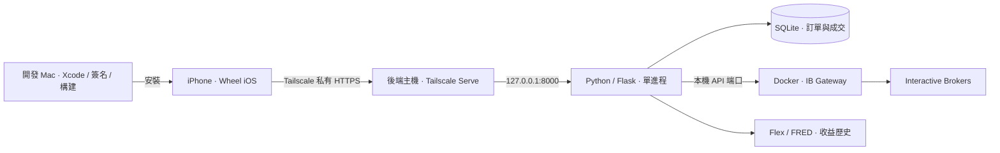

# AllYouNeedIsWheel — Wheel Trading for IBKR

[English](README.md) · [简体中文](README.zh-CN.md) · **繁體中文**

> 本頁介紹與安裝說明對應 [`codex/chart-labels-1.7`](https://github.com/WahBun/AllYouNeedIsWheel/tree/codex/chart-labels-1.7) 分支。`main` 保留其自身程式碼歷史；請按下文指定分支建置，不以首頁所在分支推斷最新 App 版本。

An unofficial, self-hosted iOS trading workstation for Interactive Brokers.

**Wheel 策略的原生 iPhone 工作台。** 用一個 App 查看 IBKR 持倉、比較收益、篩選現金擔保看跌期權（CSP）和備兌看漲期權（CC），並管理訂單。

SwiftUI 構建，支持 iOS 18 及以上，以及淺色／深色模式。當前 UI 開發統一使用英文；已有本地化資源保留，完整中文本地化待功能與交互成熟後統一整理。App 連接你自己運行的後端；IB 登錄、行情連接和資料庫留在後端主機，iPhone 不保存 IB 密碼。

項目保留了原有網頁介面，作為同一後端的輔助入口。日常使用與介面開發以 **iOS App** 為主。

> 本文對應當前 iOS 開發版本。源碼構建安裝不等於 App Store 發佈；更新 GitHub、更新後端服務和安裝手機 App 是三個獨立步驟。

## 當前階段與版本

截至 **2026-10-16**，項目以日常使用和穩定性維護為主：先持續使用，遇到實際問題再做最小修復，暫不擴展大量新功能或重構現有佈局。保留現有 1／2／3／4 圖佈局、tick 級行情刷新及已驗證的交易交互；這一維護方向不代表所有場景或 Live 交易均已驗收。

正式程式碼以 [WahBun/AllYouNeedIsWheel](https://github.com/WahBun/AllYouNeedIsWheel) 的指定分支和 commit SHA 為準。本文更新所在分支為 **`codex/chart-labels-1.7`**，不預設 `main` 是最新版本。開發程式碼、經過驗證的版本、後端主機已部署程式碼和 iPhone 已安裝 App 分別核對，不能用資料夾日期或一次 Push 代替版本確認。

推薦分工：**開發 Mac** 負責開發、Xcode 與手機構建；**後端主機** 長期運行 Gateway、Backend 和 API；開發 Mac 與 iPhone 通過 Tailscale 訪問後端主機。部署與重啓由用戶在電腦或手機上選擇執行，手機 App 的 Xcode Run 也由用戶操作。

## 閱讀導航

- 日常使用：[功能與資料邊界](#app-能做什麼)、[更新流程](#更新流程)、[常見問題](#常見問題)。
- 首次安裝：按下文第 1–7 節完成；後端主機已安裝服務時請直接查看更新流程，不重復執行首次啓動步驟。
- 專項說明：[iOS 構建與操作](https://github.com/WahBun/AllYouNeedIsWheel/blob/codex/chart-labels-1.7/ios/README.md)、[賬戶與運維](https://github.com/WahBun/AllYouNeedIsWheel/blob/codex/chart-labels-1.7/docs/MAC_MINI_TAILSCALE.md)、[Performance](https://github.com/WahBun/AllYouNeedIsWheel/blob/codex/chart-labels-1.7/docs/PERFORMANCE.md)、[行情刷新基線](https://github.com/WahBun/AllYouNeedIsWheel/blob/codex/chart-labels-1.7/docs/MARKET_DATA_BASELINE.md)。

## 介面預覽

以下為此前保存的 iPhone 模擬器截圖，使用 App 內置 **Demo 合成資料**，不代表真實賬戶或成交，也不保證與當前分支每個控件完全一致。實際佈局以當前安裝版本為準。

| Portfolio · 持倉概覽 | Trade · CSP / CC | Orders · 訂單管理 |
| :---: | :---: | :---: |
|  |  |  |

## App 能做什麼

| 頁面 | 主要功能 |
| --- | --- |
| **Portfolio** | 淨資產、可折疊現金與流動性、初始保證金及槓桿佔比；股票與期權持倉、成交入場價、剩餘天數和盈虧；資產分配、持倉分享、平倉與移倉入口。 |
| **Performance** | MTD／YTD／ALL 收益曲線（預設 YTD），可選 Portfolio only、SPX、NDX 或 SPX + NDX（預設兩項對比），拖動查看日期與收益，日內盈虧及臨時收益估算。 |
| **Trade** | CSP → CC 工作流，選擇到期日與行權價、查看 bid／mid／ask、價差及 Greeks；合約數量和限價編輯、權利金估算、CSP 初始保證金變化預估、單筆或批量暫存訂單。 |
| **Orders** | 待處理訂單、部分及全部成交記錄；Today／7 Days／MTD 日期篩選、標的搜索、Stock／Future／Option 分類；手續費保留兩位小數；訂單詳情、編輯、執行、撤單與成交通知。 |
| **Supercharts** | 股票、期貨和期權圖表入口；持倉均價、關聯期權行權價、成交標記、多週期 EMA、ATR、Bar Count、FVG、Previous values、波動通道／極值儀表與繪圖工具；標的搜索和跨端收藏。 |
| **Settings** | Demo／Live／Paper 切換、Gateway 自動登錄狀態、私有 HTTPS 連接、語言、主題及自定義顏色。 |

CC 可用數量依據持股數量、已有空頭 CALL 和佔用中的賣出訂單計算，而不是簡單地把全部股票除以 100。持倉的入場價來自可靠匹配的成交記錄；無法確定時留空，不用委託價或扣費後持倉成本冒充。

SGOV、VTI、QQQ、SPY、VOO 有專屬名稱與資產分配動效。VTI／QQQ／SPY／VOO 仍可用於 Trade；SGOV 排除在 Trade 候選之外。裝飾動畫支持減少動態效果，並在後台或對應視圖離開時暫停。

### Supercharts 與 𝔹𝕖𝕟 指標

從持倉詳情的 **𝑺𝒖𝒑𝒆𝒓𝒄𝒉𝒂𝒓𝒕𝒔** 或 Trade 的圖表入口打開。進入圖表以看走勢為主，不自動鋪設下單預覽；需要時點擊價格旁的 **+**。支持 1／2／3／4 圖佈局、週期切換、RTH／ETH、全屏和可保存樣式的繪圖工具。

- **持倉與成交**：正股顯示股數，期權／期貨顯示合約數，空頭用負號；正股圖可同時顯示相關期權的行權價。Positions 開關隱藏／顯示這些持倉標記。成交箭頭按訂單歸組，同一訂單分批成交合併數量，獨立訂單分別顯示；點擊箭頭查看詳情。
- **𝔹𝕖𝕟**：指標欄預設收起，設置按 Inputs／Style／Visibility 分組。包含三組可獨立設定的 EMA（預設長度 20，支持多週期）、ATR、Bar Count、FVG、Previous values、Volatility Channels 和 Intraday Extreme Gauge。各項顯示與樣式可設定，指標的可用性取決於標的及相關資料。
- **加載與狀態**：歷史 K 線和已獲取的多週期 EMA 歷史可在重啓後先從快取顯示，再刷新。首次打開仍依賴 IB 歷史資料；快取、凍結、延遲和缺失狀態不等於實時行情。Demo 不提供完整圖表行情，圖表需連接後端。
- **標的與收藏**：搜索股票／期貨，或按標的 → 到期日 → Call／Put → 行權價選擇精確期權合約。網頁與原生 App 通過同一後端共享合約收藏（最多 100 項）；選擇標的不會創建訂單，收藏同步也不等於交易狀態或全部顯示設置同步。
- **繪圖同步**：同一合約只提供 **Main chart only**（電腦／手機主圖顯示，副圖隱藏）和 **All charts**（兩端主圖及副圖均顯示）。兩項都通過同一後端跨設備同步，不按 K 線週期篩選；激活或放大副圖不會改變它的主副圖身份。繪圖不是券商訂單。
- **交易能力**：股票、期貨與受支持的標準 USD 期權可按賬戶能力使用圖表交易。Join、入場、TP／SL、Add、Trim、BE、Close 是否可用，以當前賬戶、持倉、合約及後端能力開關為準；已有保護單、覆蓋數量和未確認結果可能限制操作。Live 並非連接後即可任意交易，模擬測試也不等於實盤驗收。
- **價格拖動**：One-click trading 開啓時，松開可編輯的入場或 TP／SL 線會通過現有校驗提交修改；關閉時保留草稿，等待 Confirm／Discard。普通行情刷新不應丟失草稿，真實成交、撤單或訂單身份變化仍會觸發重新核對。
- **圖表盈虧**：Daily P&L 對應當前精確合約與所選賬戶的 IBKR 資料；超過 15 秒未更新時顯示 `Daily P&L · Stale`，不可用不顯示成零。顯示 `Realized today` 時使用已保存的 IB 成交已實現盈虧，含義與 IB 的每日盯市 P&L 不同。

### 成交記錄篩選

Executed records 預設 **Today**，可切換 **7 Days** 或 **MTD**（美東本月 1 日至今）。右側 **🔍** 點擊展開搜索，**Filter** 按 Stock／Future／Option 篩選，三個條件可以組合。搜索鍵、Done 或滑動列表可收起鍵盤。

日期篩選作用於 App 已取得的成交記錄，不承諾補全 IB 全部歷史；沒有可靠成交時間的記錄不混入日期範圍。手續費僅在顯示時四捨五入為兩位小數，原始計算精度保留。

### Demo / Live / Paper


- **Demo**：使用本地合成資料，不連接 IB。隱藏地址和 Connect，已保存的後端地址仍保留。
- **Paper**：使用 IBKR 模擬賬戶。設定好自動登錄後，選擇即切換後端連接，復用已登錄的 Paper 會話或啓動 Gateway，核對實際賬戶後自動恢複資料。
- **Live**：復用已登錄的 Live 會話；需要重新認證時自動選擇 IB Key 驗證設備，收到通知後需本人在手機確認。App 核對實際賬戶，不會僅憑選中 Live 就顯示實盤已連接。

首次使用需在後端主機設定 `paper`／`live` 兩份連接設定、獨立資料庫及本機私有登錄憑據；憑據不進入 GitHub，也不發送到 iPhone。自動登錄是可選功能，未設定時仍需手動登錄 Gateway。具體設定見[賬戶切換與自動登錄](https://github.com/WahBun/AllYouNeedIsWheel/blob/codex/chart-labels-1.7/docs/MAC_MINI_TAILSCALE.md#ios-account-selector)。單 Gateway 自動登錄控制器預設使用 `~/Docker/ib-gateway/docker-compose.yml`；若採用下方的 `~/Services/wheel-gateway`，請設置 `WHEEL_GATEWAY_COMPOSE_DIR` 指向該目錄。

後端只有一個當前賬戶，所有客戶端共享這個選擇。切換不平倉、不撤單；App 清理舊賬戶畫面，後端拒絕舊會話的寫入請求。啓用賬戶設定後，不支持賬戶會話標識的舊網頁客戶端只能讀取。

**Live ⇄ Paper 快速切換**：可選的同容器雙會話模式讓 Live 和 Paper 保持後台登錄。切換時只更換 Wheel 的賬戶連接，不重啓 Gateway；會話有效時無需反復進行 IB Key 驗證。兩邊使用各自的賬戶連接、資料庫和行情，訂單仍歸屬經過核對的當前賬戶。

**歷史驗收記錄（2026-10-07，並非當前在線狀態檢查）**：用戶已在手機確認雙向切換流暢；當時後端接口測得 Live → Paper 約 **0.78 秒**、Paper → Live 約 **0.95 秒**，兩邊均恢復實時行情。此為賬戶核對完成的接口耗時，不等於手機整頁或首次圖表加載時間。已修復舊賬戶的圖表訂閱冷卻影響新賬戶首次加載的問題；當次復測未出現該場景的 503。

首次啓動、會話失效或 IB 要求重新認證時，仍需等待登錄及本人確認，不能保證固定秒數。上述歷史驗收中，同一容器內的雙會話取得了現有訂閱的實時行情；這不代表兩個獨立容器或任意設備組合都支持共享。雙會話模式需顯式設定，原單 Gateway 與單向預熱方案保留作回退；下方首次部署示例仍是 Paper／唯讀單實例。實現、啓用設定與驗證記錄見[雙 Gateway 會話與切換驗收](https://github.com/WahBun/AllYouNeedIsWheel/blob/codex/chart-labels-1.7/docs/acceptance/2026-10-07-dual-gateway.md)。

上述歷史連接與行情驗收未下單、改單或撤單，不替代交易流程及開市負載驗收。

### 資料與訂單的含義

- **Demo** 是合成資料和本地模擬操作，不是 IB 模擬盤。連接 Paper Gateway 才是在使用 IB 模擬賬戶。
- **暫存不等於成交**：Trade 票據先建立草稿，Orders 的 Execute 才提交到 IB；圖表交易使用自己的預覽／確認和 One-click 路徑，並非所有操作都會先進入草稿列表。執行／撤單確認偏好可在訂單設置中調整。
- 外部 IB 訂單唯讀；提交結果不確定時鎖定進一步寫入，先覈實 IB 的訂單與成交，再解除鎖定。不會因超時自動補發交易請求。
- Frozen、過期或缺失報價不會變成可執行的實時價格。連接成功不代表具備全部市場資料權限。
- 收益歷史來自 Flex 每日 TWR；SPX／NDX 使用 FRED 的 SP500／NASDAQ100 每日價格指數，不含股息再投資。日內估算不是正式 TWR，最終以之後的 Flex 報表為準。
- 移倉的兩條腿分別暫存、分別執行，不是原子組合單；保證金影響是 IB what-if 估算，不是各持倉可相加的保證金分攤。

### 刷新、成本與診斷

- **圖表與列表分別刷新**：圖表使用 SSE 推送和 tick 驅動的價格／OHLC 更新，斷線後按序列與快照恢復；下述 1／2 秒間隔是列表和票據讀取，不是圖表刷新上限。實際資料到達頻率受 IB、行情權限、市場活動及網路影響。基線與測量邊界見[行情刷新基線](https://github.com/WahBun/AllYouNeedIsWheel/blob/codex/chart-labels-1.7/docs/MARKET_DATA_BASELINE.md)。
- **報價新鮮度**：最新成交價與可執行 bid／ask 不等價；只有有效實時盤口更新或同側有效價格配合正數量更新才能刷新相應可執行報價狀態，快取、延遲資料和本地計時不能冒充。圖表 OHLC 更新也不證明實時成交量完整，未知成交量不填零。

- 單標的交易詳情和平倉頁約每 1 秒刷新；Portfolio 和 Trade 列表通常約每 2 秒刷新。讀取順序執行，失敗退避，隱藏頁面暫停，實際間隔受請求耗時影響。
- 持倉期權指標在確認休市且行情凍結時每 30 秒檢查，避免把正常缺失的 Delta／IV 當成故障持續重試。盤中缺失仍快速重試；開市也不保證全部指標可用，取決於 IB 資料返回和權限。
- 股票詳情可顯示匹配的 IB 報表平均成本、報表日期及數量，與 Gateway 當前成本分別標注。報表資料不直接覆蓋交易輸入或實時盈虧，數量不一致時提示核對。
- CSP 的初始保證金是 IB What-if 返回的預計變化，可手動刷新；正值表示增加佔用，負值表示減少佔用，不等於現金擔保金額。預估不會提交真實訂單。
- 訂單移出待處理列表後，詳情保留已確認的結束記錄與成交資料；未取得最終結果時明確顯示待覈實，不能僅憑“消失”判斷成交或撤單成功。
- 點擊 **Portfolio／Orders 頂部狀態欄 → Diagnostics** 可預覽和複製脫敏診斷。內容包括版本、刷新狀態、錯誤類別及可用的請求編號；不複製原始錯誤、賬戶、持倉、私人地址或憑據。剪貼板僅本機可用，5 分鐘後過期。

## 部署架構

“後端主機”指運行 IB Gateway、Wheel API 和資料庫的常開電腦，不限定具體 Mac 型號；“開發 Mac”指運行 Xcode 的 Mac，兩者可以是同一台。以下安裝、自啓動和維護示例以 **macOS** 為準；Linux／Windows 的服務管理與預設路徑需自行適配，其他系統的部署尚未驗證。



| 設備／組件 | 職責 |
| --- | --- |
| 開發 Mac | 主開發機：Xcode、Simulator、SwiftUI、簽名與真機安裝。 |
| 後端主機 | 長期運行：Docker Gateway、Python 後端、SQLite、Tailscale。 |
| iPhone | 查看和操作 App，通過 Tailnet 訪問後端主機。 |
| GitHub | 正式程式碼來源；換電腦前 Commit → Push，另一台 Pull 後再開發。 |

**下文的 Docker 只運行 IB Gateway。Wheel 後端運行在後端主機的 Python 虛擬環境里**，不是整個項目都放進一個容器。倉庫沒有一鍵全棧 Docker 部署腳本。

## 1. 準備環境

- **後端主機**：Git、Python 3.10+、Docker Desktop、Tailscale；保持聯網，避免系統休眠。
- **開發 Mac**：Git、能編譯本項目並支持目標設備的 Xcode、Apple ID／開發簽名；真機需 iOS 18+。
- **iPhone**：Tailscale，與後端主機加入同一 Tailnet。
- **IBKR**：有效的 Gateway 登錄、目標賬戶及需要的行情權限。先用 Paper／唯讀路徑驗證。

先在後端主機克隆並安裝後端依賴：

```sh
mkdir -p "$HOME/Projects"
cd "$HOME/Projects"
git clone --branch codex/chart-labels-1.7 https://github.com/WahBun/AllYouNeedIsWheel.git
cd AllYouNeedIsWheel
git branch --show-current
git rev-parse HEAD
python3 -m venv .venv
source .venv/bin/activate
python -m pip install -r requirements.txt
cp connection.json.example connection.json
```

本例明確使用本文對應分支；若維護分支變更，應先核對 GitHub 的目標分支和 SHA。已有安裝不要重新克隆到運行目錄、覆蓋設定或資料庫；先查看 `git status`、當前分支和 SHA，再按[更新流程](#更新流程)操作。

## 2. 後端主機：Docker 運行 IB Gateway

使用 [gnzsnz/ib-gateway-docker](https://github.com/gnzsnz/ib-gateway-docker) 的鏡像；它是獨立上游項目。下面為首次部署的 Paper／唯讀示例，不是現有服務的重置命令。

在倉庫外創建私有目錄並進入：

```sh
mkdir -p "$HOME/Services/wheel-gateway"
cd "$HOME/Services/wheel-gateway"
```

在該目錄保存 `docker-compose.yml`：

```yaml
services:
  ib-gateway:
    image: ghcr.io/gnzsnz/ib-gateway:stable
    restart: unless-stopped
    environment:
      TWS_USERID: ${TWS_USERID:?Set TWS_USERID}
      TWS_PASSWORD: ${TWS_PASSWORD:?Set TWS_PASSWORD}
      TRADING_MODE: ${TRADING_MODE:-paper}
      READ_ONLY_API: ${READ_ONLY_API:-yes}
      VNC_SERVER_PASSWORD: ${VNC_SERVER_PASSWORD:?Set VNC_SERVER_PASSWORD}
      TWS_SETTINGS_PATH: /home/ibgateway/tws_settings
    ports:
      - "127.0.0.1:4001:4003"
      - "127.0.0.1:4002:4004"
      - "127.0.0.1:5900:5900"
    volumes:
      - gateway-settings:/home/ibgateway/tws_settings
volumes:
  gateway-settings:
```

同目錄新建 `.env`，僅在後端主機本地填寫：

```dotenv
TWS_USERID=YOUR_PAPER_USERNAME
TWS_PASSWORD=YOUR_PAPER_PASSWORD
VNC_SERVER_PASSWORD=YOUR_PRIVATE_VNC_PASSWORD
```

```sh
chmod 600 .env
docker compose pull
docker compose up -d
docker compose ps
```

在後端主機上用螢幕共享／VNC 客戶端連接 `vnc://127.0.0.1:5900`，檢查 Gateway 登錄與 API 設置，按要求完成 IB Key／雙重驗證。不要把 VNC 或 IB API 端口暴露到公網。Docker 啓動成功不等於 Gateway 已登錄。

該鏡像的 **Paper 轉發端口是容器內 4004 → 後端主機 4002**；Live 對應容器內 4003 → 後端主機 4001。不要把容器轉發端口與 Gateway 內部端口混用。Apple Silicon 應選擇上游支持 ARM64 的鏡像版本；驗證成功後固定版本或 digest，避免無計劃升級。端口與設定細節見[上游部署說明](https://github.com/gnzsnz/ib-gateway-docker#ports)。

Docker Desktop 需要隨用戶登錄啓動；容器重啓策略不能代替它，也不能繞過 IB 身份驗證。不要為 Wheel 再啓動一個與既有賬戶會話衝突的 Gateway。

## 3. 後端主機：連接 Python 後端

回到克隆的項目根目錄（本例為 `~/Projects/AllYouNeedIsWheel`），再編輯 `connection.json`，與上一步保持一致：

```json
{
  "host": "127.0.0.1",
  "port": 4002,
  "client_id": 1,
  "readonly": true,
  "account_id": "YOUR_PAPER_ACCOUNT_ID",
  "db_path": "options_dev.db"
}
```

`client_id` 要固定且不與其他應用衝突；`account_id` 必須是實際目標賬戶。文件名不決定 Paper／Live，實際 Gateway 會話、端口及賬戶才決定。

```sh
cd "$HOME/Projects/AllYouNeedIsWheel"
source .venv/bin/activate
python run_api.py
```

另一個終端驗證：

```sh
curl --fail http://127.0.0.1:8000/health
curl --fail http://127.0.0.1:8000/api/portfolio/bootstrap
curl --fail http://127.0.0.1:8000/api/options/market-session
```

`/health` 只說明 HTTP 服務正常；還要確認持倉接口返回正確賬戶的資料。不要把賬戶響應或未經脫敏的日誌放到公開 issue。

後端維持 **一個進程、八個 HTTP 線程、一個串行 IB 執行線程**。相同讀取可以合併等待，寫入不合併、不自動重試。不要通過增加 Gunicorn worker 數來提速，也不要重復啓動後端。

`run_api.py` 是首次手動啓動入口，會檢查並嘗試補裝缺失依賴；已有常駐服務時不要再運行它。它按命令行參數設置連接設定，自定義 `CONNECTION_CONFIG` 應使用運維指南中的直接 Gunicorn 啓動方式，不能假設該環境變量會被此腳本保留。

準備開啓交易時，分別核對 Gateway 的 Read-Only API、後端 `readonly`、目標賬戶及對應資產的 Live 能力開關。使用 Live 時還需對應的 Gateway 會話與端口；`python run_api.py --realmoney` 僅選擇 `connection_real.json`，本身不會證明當前是正確實盤賬戶。

## 4. 後端主機 → iPhone：Tailscale 私有 HTTPS

後端主機、開發 Mac 和 iPhone 加入同一 Tailnet，訪問策略只允許所需設備訪問。開啓 MagicDNS 和 HTTPS 支持，然後在後端主機執行：

```sh
tailscale status
tailscale serve --bg --https=443 http://127.0.0.1:8000
tailscale serve status
```

使用 Serve 輸出的**完整 HTTPS 域名**，例如：

```text
https://YOUR-BACKEND.YOUR-TAILNET.ts.net
```

在 iPhone 保持 Tailscale 連接，用 Safari 打開該域名的 `/health`，再在 Wheel → Settings 填入同一根地址，點擊 Connect。外出使用前再通過蜂窩網路驗證一次。

不要使用 Funnel 或路由器公網端口轉發；不要跳過 TLS 證書驗證。`--bg` 保存後台 Serve 設定，但仍依賴後端主機和 Tailscale 在線。域名證書會進入公開證書透明度日誌，因此設備名不宜包含私人信息。見 [Tailscale Serve 官方說明](https://tailscale.com/docs/features/tailscale-serve)和[命令參考](https://tailscale.com/docs/reference/tailscale-cli/serve)。

## 5. 開發 Mac：構建並安裝 iOS App

在開發 Mac 克隆同一個倉庫，打開 `ios/Wheel.xcodeproj`。App 無外部 Swift 包依賴。

在 `ios/Signing.xcconfig` 同目錄創建被 Git 忽略的 `Signing.local.xcconfig`：

```xcconfig
DEVELOPMENT_TEAM = YOUR_TEAM_ID
PRODUCT_BUNDLE_IDENTIFIER = com.yourname.wheel
```

在 Xcode 的 Signing & Capabilities 確認自己的 Team 與自動簽名。保持同一 bundle identifier 才是對現有 App 的更新；換標識會成為另一個安裝。

1. 首次用線連接並解鎖 iPhone，確認信任，按系統要求啓用開發者模式。
2. 選擇自己的 iPhone 作為運行目標，構建安裝。
3. 常規體驗選擇 **Wheel Wireless** scheme：Debug 構建，但啓動不附加 LLDB，減少無線調試帶來的啓動與交互開銷。
4. 需要斷點和調試時使用 **Wheel** scheme。
5. App 首次從 Demo 開始；選擇 Paper 或 Live 顯示連接區域，填寫前一節的 HTTPS 地址，再點 Connect。首次自動登錄需先完成上述後端賬戶設定。

### 無線 Run

先完成一次有線配對，在 Xcode 的 Devices and Simulators 確認設備可用／網路連接已啓用，再拔線。開發 Mac 與 iPhone 應位於允許設備互訪的同一局域網；訪客 Wi-Fi、客戶端隔離或 VPN 規則可能阻斷調試。

手機螢幕鏡像的系統要求與 Xcode 無線安裝不是同一件事。Tailscale 解決 App 到後端主機的連接，也不等於已經設定好 Xcode 到 iPhone 的無線調試。

Simulator 可直接運行 Demo；它不證明真機簽名、無線連接或實盤行情已驗證。簽名賬號的有效期與設備限制以 Apple 當前規則為準。

## 6. 設定 Performance 收益歷史

Portfolio 能讀取不代表收益歷史已設定。後端主機還需要 IBKR Flex 的每日 Change in NAV，包含 TWR、From／To Date、Starting／Ending Value，並按日拆分；CSV 需包含 CNAV section code；賬戶需與 Gateway 設定一致。

在後端主機創建私有文件：

```text
~/Library/Application Support/Wheel/performance/config.json
```

```json
{
  "token": "YOUR_FLEX_TOKEN",
  "query_id": "YOUR_FLEX_QUERY_ID",
  "account_id": "YOUR_CONFIGURED_GATEWAY_ACCOUNT",
  "history_path": "/ABSOLUTE/PRIVATE/PATH/performance-history.sqlite3"
}
```

先創建父目錄，將文件權限設為 `600`；`history_path` 的父目錄也應存在且可寫。也可用後端環境變量 `WHEEL_PERFORMANCE_CONFIG` 指定另一個私有設定文件，或用 `report_path` 導入已有 CSV／XML。

Token 不放進 App、Git 或 `connection.json`。Flex 使用獨立私有設定，連接設定和診斷文件不應充當密鑰容器。收益檔案要單獨備份；ALL 展示實際保存的歷史，不會憑空補全建倉以來缺失的日期。報表格式、快取與估算邊界見 [Performance 設定說明](https://github.com/WahBun/AllYouNeedIsWheel/blob/codex/chart-labels-1.7/docs/PERFORMANCE.md)。

## 7. 長期運行與更新

後端主機的 Python 後端可用 LaunchAgent 在用戶登錄後啓動，完整 plist、加載與停止命令見 [後端主機運維指南](https://github.com/WahBun/AllYouNeedIsWheel/blob/codex/chart-labels-1.7/docs/MAC_MINI_TAILSCALE.md#3-macos-登录后自启动)。預設加載 `connection.json`；若實際使用其他文件，必須在 LaunchAgent 的 `EnvironmentVariables` 中明確設定 `CONNECTION_CONFIG`。自定義 Flex 路徑同樣通過環境變量傳入。

重啓後端主機後，FileVault 解鎖、用戶登錄、Docker Desktop、Gateway 登錄、Tailscale 和後端分別確認。不要把“容器自動重啓”當成全鏈路已恢復。

### 後端主機自動維護

倉庫提供兩項獨立的用戶級維護任務，均需在後端主機安裝；僅拉取程式碼不會自動啓用：

| 任務 | 行為與邊界 |
| --- | --- |
| Docker 看護 | 檢測異常並按保護條件嘗試恢復；涉及重啓時會中斷 Gateway，仍可能需要 IB Key 或手動登錄。不是固定週期無條件重啓。 |
| 資料備份與日誌輪轉 | 每小時檢查；使用 SQLite 在線備份，每個 UTC 日期保存一份訂單庫和已設定的 Performance 歷史庫，完整性校驗後保留最近 14 份。Gunicorn 訪問／錯誤日誌達到 20MiB 後輪轉，保留 7 個歸檔。 |

維護腳本目前使用項目根目錄的 `options_dev.db`。若後端使用自定義資料庫路徑，安裝前必須調整腳本與實際設定一致；自定義 Flex 設定路徑也需傳入維護任務，不能只設定後端進程。

備份保存於後端主機的 `~/Library/Application Support/Wheel/Maintenance` 私有目錄，不進入 GitHub。它們可用於本地恢復，**不能抵御同一塊磁盤故障或整機丟失**。日誌通過 Gunicorn 重新打開文件實現輪轉，不重啓 worker；此任務不截斷 LaunchAgent 輸出和其他應用日誌。

安裝命令、狀態文件、故障檢查及恢復注意事項見 [後端主機運維指南](https://github.com/WahBun/AllYouNeedIsWheel/blob/codex/chart-labels-1.7/docs/MAC_MINI_TAILSCALE.md)。這些任務依賴用戶已登錄和後端主機在線。系統應避免自動休眠；如後端主機同時通過通用控制共享鍵鼠，顯示器熄屏策略需兼顧日常操作。

### 更新流程

1. **開發 Mac 修改並推送**：確認當前分支和工作區，完成直接相關驗證，再 Commit → Push。保留未提交改動；設定、IB／Flex 憑據、資料庫、日誌、私有地址及個人簽名信息不進入 Git。
2. **電腦或手機預覽版本**：打開已設定的 **Wheel Backend** 快捷指令，選擇 **Deploy latest**，核對分支、當前 SHA、目標 SHA、提交說明和重啓建議。確認後部署固定的目標 SHA，不隨之後的新提交改變。
3. **用戶選擇部署方式**：在第二層菜單選擇 **Deploy only** 或 **Deploy & Restart Backend**；只想重啓現有版本時使用外層的 **Restart Backend only**。取消預覽或選擇菜單不會部署或重啓。
4. **按變更覈實結果**：核對後端主機的目標 SHA、Backend 健康和實際頁面；網頁資源更新後刷新頁面。涉及 iOS 原生程式碼或 App 內置圖表資源時，還需在開發 Mac 用 Xcode 構建安裝，GitHub Push 和後端主機部署不會自動更新手機 App。

| 選項／提示 | 含義 |
| --- | --- |
| **Deploy only** | 更新後端主機程式碼並檢查健康，保持 Backend 進程不變；不代表運行中的 Python 已加載新程式碼。文檔等無需重啓的更新通常選此項。 |
| **Deploy & Restart Backend** | 更新到確認的 SHA，再重啓 Wheel Backend 並檢查新進程和健康；不會重啓 Gateway。應在沒有訂單請求進行中或結果待確認時執行。 |
| **No restart expected** | 已識別的變更預計不需要 Backend 重啓；網頁刷新或 iPhone 重新構建仍可能需要。 |
| **Restart recommended** | 存在 Backend Python、快取模板等變更，建議部署並重啓；也會考慮此前僅部署但尚待重啓的變更。 |
| **Review required** | 依賴、遷移、設定或未分類文件需要先檢查，不能假設一次重啓即可完成更新。 |

重啓建議只是提示，最終由用戶選擇。每次修復交付應說明驗證範圍、建議的部署方式和原因；後端、網頁及手機端的實際驗收分別記錄。健康檢查通過不等於券商連接、賬戶、行情或下單已驗收。

快捷指令由後端主機自行從 GitHub 獲取已推送程式碼；完成首次設定後，電腦或手機均可操作，開發 Mac 不必保持開機。後端主機、Tailscale、GitHub 訪問和設備已有 SSH 授權仍需可用。版本預覽只確認程式碼版本和更新建議，不代表完整部署成功或手機 App 已更新。後端主機讀取 GitHub 的認證與手機連接後端主機的 SSH 授權是兩回事，首次設定需分別核對。

部署會檢查工作區、分支和前進方向，並保留程式碼回退點；不會強制覆蓋衝突、自動安裝依賴或遷移資料庫。更新前按需要備份私有設定和資料庫；運行中的 SQLite 使用在線 backup API／`.backup`。不要用 `git reset --hard`、刪除資料庫或清除未完成部署記錄來繞過問題，也不要在斷線後盲目重發交易請求。

詳細說明見 [Wheel Backend 快捷指令](https://github.com/WahBun/AllYouNeedIsWheel/blob/codex/chart-labels-1.7/docs/BACKEND_SHORTCUT.md#choose-whether-to-restart-2026-10-16) 與 [開發 Mac → 後端主機部署工具](https://github.com/WahBun/AllYouNeedIsWheel/blob/codex/chart-labels-1.7/docs/DEPLOY_MINI.md)。後者是另一種部署入口，其命令會請求 Backend 重啓，不等同於快捷指令的 Deploy only。

### 日常問題反饋

遇到問題時，記錄所在頁面、操作步驟、預期與實際結果、發生時間，以及 Demo／Paper／Live 模式；附截圖或已脫敏的 Diagnostics，並盡量提供後端分支／SHA 和手機安裝版本。行情問題說明標的、週期和是否開市；訂單問題保留券商側狀態用於核對，不通過刪記錄或重復提交來復現。

修復圍繞真實使用路徑展開，保留現有佈局和已穩定行為。涉及 UI、交互、行情刷新、訂單鏈、狀態同步或斷線恢復時，先用 REA 分析相關實現或運行證據，再做最小修復和必要驗證；未在實際頁面、設備或券商環境驗證的範圍明確標注。

## 常見問題

| 現象 | 排查順序 |
| --- | --- |
| App 無法連接 | 後端主機本機 `/health` → 持倉接口 → 兩端 Tailscale → HTTPS 域名與策略。 |
| 安全連接失敗／`-1200` | Safari 打開同一地址，核對時間、證書、Tailscale 和代理干擾；不要關閉證書驗證。 |
| 有持倉但沒有報價 | Gateway 登錄、行情權限、合約是否可報價、市場狀態；舊／凍結資料不是實時價。 |
| 收益圖為空 | Flex 設定、賬戶對應關係、每日 TWR 與本地收益檔案；Demo 不提供真實收益歷史。 |
| HTTP 503／首次報價慢 | 串行 IB 隊列或合約首次確認可能耗時；等待讀取恢復，不要重復提交交易。 |
| 無線 iPhone 不可用 | 首次配對、解鎖、同網段設備互訪、VPN 和路由器隔離規則。 |
| 無線 Run 後啓動卡頓 | 使用不附加調試器的 Wheel Wireless；調試時切回 Wheel。 |
| 訂單狀態不確定 | 核對 IB 的準確訂單與部分成交，再處理鎖定；不自動補單。 |
| 需要反饋連接或刷新異常 | 點擊 Portfolio／Orders 狀態欄，預覽並複製 Diagnostics；可同時提供介面截圖。 |

Trade 自動報價參考 NYSE 常規交易日曆，包括假期、提前收盤與夏令時；這不是所有股票、期權或延長交易時段的交易許可判斷。Performance 的盤中延長曲線仍是有限條件下的估算。

## 開發與驗證

```sh
# 從倉庫根目錄執行；後端先激活已安裝依賴的虛擬環境
# 隔離回歸禁止網絡、真實 IB 構造及持久數據庫訪問
python tests/run_chart_offline.py

# 前端單元測試：需已安裝支持 node:test 的 Node.js
npm run test:frontend

# iOS：先列出可用模擬器，再將 SIMULATOR_ID 替換為本機目標
xcrun simctl list devices available
xcodebuild -project ios/Wheel.xcodeproj -scheme Wheel \
  -destination 'platform=iOS Simulator,id=SIMULATOR_ID' test

git diff --check
```

以上是驗證入口，不表示當前提交已運行全部測試。圖表瀏覽器交互回歸位於 `tests/chart/*.cjs`，不包含在 `npm run test:frontend` 內；它們需要獨立的 Playwright／瀏覽器環境，設定和行情矩陣見[行情刷新基線](https://github.com/WahBun/AllYouNeedIsWheel/blob/codex/chart-labels-1.7/docs/MARKET_DATA_BASELINE.md#repeatable-checks)。按變更選擇相關檢查，避免直接在生產設定上啓動測試服務。

模擬測試不構成券商驗收。通過編譯和回歸不等於已驗證盤中延遲、真實成交、所有網路故障或所有 iOS 設備；真實 Paper 訂單需明確授權，Live 交易由用戶操作。

```text
iOS 開發入口：ios/Wheel.xcodeproj
原生界面與狀態：ios/Wheel/
iOS 回歸：ios/WheelTests/
後端路由與服務：api/
IB 連接與配置：core/、config.py
訂單數據庫：db/
後端與網頁回歸：tests/
輔助網頁：frontend/
部署與數據說明：docs/
```

更多開發細節見 [iOS 指南](https://github.com/WahBun/AllYouNeedIsWheel/blob/codex/chart-labels-1.7/ios/README.md)。原網頁與 App 共用後端，適合輔助核對；瀏覽器偏好不會自動遷移到 App。

## License & Credits

[Apache License 2.0](https://github.com/WahBun/AllYouNeedIsWheel/blob/codex/chart-labels-1.7/LICENSE)。項目基於 [xiao81/AllYouNeedIsWheel](https://github.com/xiao81/AllYouNeedIsWheel) 延續開發。感謝 [TradingView Lightweight Charts](https://github.com/tradingview/lightweight-charts)、[ib_async](https://github.com/ib-api-reloaded/ib_async)、SwiftUI／Charts、Flask，以及 [IB Gateway Docker](https://github.com/gnzsnz/ib-gateway-docker) 與 [Tailscale](https://tailscale.com/) 提供的基礎工具。
